# SignLingo AI

**Ứng dụng web học bảng chữ cái ngôn ngữ ký hiệu Mỹ (ASL) bằng webcam, kiểu Duolingo. AI chấm ngay trong trình duyệt, hình camera không rời khỏi máy người học.**

Đồ án cuối kỳ môn **Nhập môn Trí tuệ nhân tạo (Introduction to AI)**, VNUK.

| | |
|---|---|
| Bản chạy | **https://signlingo-vn.vercel.app** |
| Báo cáo cuối kỳ (IEEE) | [`docs/final-report/`](docs/final-report/) |
| Kết quả thí nghiệm ML | [`ml/reports/RESULTS.md`](ml/reports/RESULTS.md) |
| Kế hoạch và trạng thái task | [`docs/07_MASTER_PLAN.md`](docs/07_MASTER_PLAN.md) |

## Mục lục

- [Thông tin nhóm](#thông-tin-nhóm)
- [Tổng quan project và công nghệ sử dụng](#tổng-quan-project-và-công-nghệ-sử-dụng)
- [Hướng dẫn cài đặt và chạy ứng dụng](#hướng-dẫn-cài-đặt-và-chạy-ứng-dụng)
- [Task 1 — Project Planning & Teamwork](#task-1--project-planning--teamwork)
- [Task 2 — Implement User Interface](#task-2--implement-user-interface)
- [Task 3 — Database Integration & Dynamic Content](#task-3--database-integration--dynamic-content)
- [Task 4 — Optimization](#task-4--optimization)
- [Deliverables Checklist](#deliverables-checklist)
- [Self-Reports](#self-reports)
- [Thông tin bổ sung](#thông-tin-bổ-sung)

---

## Thông tin nhóm

**Tên nhóm:** Ngũ Đại Hào Kiệt · **Môn:** Nhập môn Trí tuệ nhân tạo · **Trường:** VNUK

### Thành viên nhóm

| Thành viên | MSSV | Vai trò |
|---|---|---|
| Nguyễn Tuấn Hưng (trưởng nhóm) | 24090019 | AI và tích hợp |
| Nguyễn Hữu Triết | 24090003 | Hiệu năng và giao diện đa thiết bị |
| Trần Công Sanh | 24090009 | Dữ liệu và kiểm thử |
| Lê Nguyễn Thảo Anh | 24090028 | Báo cáo, thuyết trình và người dùng |
| Nguyễn Anh Dũng | 24090021 | Thiết kế giao diện và nội dung bài học |

Phân công chi tiết ở [Task 1 (a)](#a-phân-công-vai-trò). Liên hệ: hung.nguyen240919@vnuk.udn.vn (trưởng nhóm).

---

## Tổng quan project và công nghệ sử dụng

### Bài toán

Học bảng chữ cái ASL thường cần người bên cạnh sửa tay. SignLingo cho người học ra dấu trước webcam và nhận phản hồi ngay:

- **24 chữ cái tĩnh** được nhận bằng mô hình học máy (tập hợp 5 mạng MLP trên 21 điểm khớp bàn tay).
- **2 chữ động J, Z** và **số 0–10** được nhận bằng luật hình học trên vị trí các khớp.
- Lộ trình học kiểu bản đồ kẹo, XP, chuỗi ngày học, âm thanh và linh vật mèo Lingo.
- **AI Lab**: trang cho người chấm xem bằng chứng (so sánh mô hình, ma trận nhầm, rò rỉ dữ liệu, đo tốc độ trực tiếp).
- Tài khoản tùy chọn để đồng bộ tiến độ và tham gia bảng xếp hạng.

### Kiến trúc

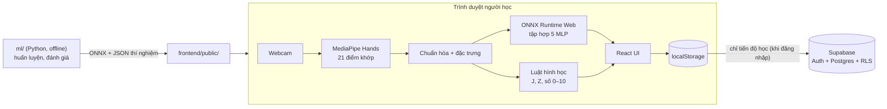

- **Không tự viết server.** Frontend là SPA tĩnh trên Vercel; backend là Supabase (dịch vụ có sẵn).
- **Quyền riêng tư:** ảnh, video và tọa độ bàn tay không rời khỏi máy. Chỉ tiến độ học (XP, bài đã học) được đồng bộ, và chỉ khi người học đăng nhập.
- App chạy đầy đủ khi không cấu hình Supabase; tài khoản là tùy chọn.

### Công nghệ sử dụng

| Lớp | Công nghệ |
|---|---|
| Giao diện | React 19, TypeScript 6, Vite 8, Tailwind CSS 4, React Router 8, Zustand 5 |
| AI trong trình duyệt | MediaPipe Tasks Vision (HandLandmarker), ONNX Runtime Web |
| Backend (có sẵn) | Supabase: Auth (email + mật khẩu), Postgres, Row Level Security, hàm RPC |
| Học máy (offline) | Python 3.11, PyTorch, scikit-learn, xuất ONNX |
| Dữ liệu | Sign Language MNIST (ảnh, đánh giá phương pháp), `keypoint.csv` (landmark, mô hình chạy trên web) |
| Kiểm thử | Vitest + Testing Library, pytest, Playwright + axe-core |
| CI/CD | GitHub Actions, Vercel |

### Kết quả chính

Mọi số dưới đây đọc từ `ml/reports/experiments/*.json` (seed cố định 42, 43, 44). Chi tiết: [`ml/reports/RESULTS.md`](ml/reports/RESULTS.md).

| Chỉ số | Kết quả |
|---|---|
| Tập hợp 5 CNN trên ảnh (Sign Language MNIST), test Macro-F1 | **0,979** |
| Baseline cổ điển tốt nhất (MLP + HOG, 3 seed), test Macro-F1 | 0,911 ± 0,003 |
| Mô hình chạy trên web (tập hợp 5 MLP landmark), test Macro-F1 | 0,778 |
| Thời gian xử lý mỗi khung trong Chrome, p50 / p95 | 29,8 ms / 38,6 ms |
| Số khung xử lý mỗi giây (cùng lần đo) | 22,6 khung/giây |
| Kích thước mô hình ONNX | 5,68 MB |

- 0,778 đo trên phần cuối của cùng tệp dữ liệu, **không phải trên người ra dấu mới**.
- Thời gian mỗi khung đo một lần, 60 giây, trên laptop của nhóm.

---

## Hướng dẫn cài đặt và chạy ứng dụng

### Yêu cầu

- Node.js 22 (xem `.nvmrc`) và pnpm 12 (`npm install -g pnpm@12`).
- Chrome hoặc Edge có webcam.
- Python 3.11, chỉ khi muốn chạy lại phần ML.

### Chạy frontend

```powershell
cd frontend
pnpm install
pnpm dev
```

Mở địa chỉ `Local:` mà terminal in ra (thường là `http://localhost:5173`). Lần đầu chạy, `pnpm dev` tự chép file MediaPipe và ONNX Runtime vào `public/` và tải mô hình bàn tay (khoảng 8 MB) từ Google; những file này không được commit. Camera chỉ hoạt động trên `localhost` hoặc HTTPS.

### Bật tài khoản (tùy chọn)

Chép `frontend/.env.example` thành `frontend/.env.local` rồi điền `VITE_SUPABASE_URL` và `VITE_SUPABASE_ANON_KEY` (khóa công khai; không bao giờ dùng khóa `service_role`). Tạo bảng bằng hướng dẫn trong [`supabase/README.md`](supabase/README.md).

### Kiểm tra mã

| Khối | Lệnh |
|---|---|
| Frontend | `cd frontend; pnpm lint; pnpm typecheck; pnpm test --run` |
| ML | `cd ml; .\.venv\Scripts\python.exe -m pytest -q; ruff check .` |
| E2E | `cd e2e; pnpm playwright test` (đặt `$env:PW_CHANNEL='chrome'` để dùng Chrome đã cài) |

### Chạy lại pipeline ML

Cài đặt, nguồn dữ liệu và các bước pipeline ở [`ml/README.md`](ml/README.md). Dữ liệu thô không được commit.

---

## Task 1 — Project Planning & Teamwork

### (a) Phân công vai trò

| Thành viên | Phụ trách |
|---|---|
| Nguyễn Tuấn Hưng | Huấn luyện mô hình nhận diện, nhận diện trong trình duyệt, lộ trình bài học và AI Lab, tài khoản và bảng xếp hạng |
| Nguyễn Hữu Triết | Tối ưu điểm Lighthouse, tối ưu giao diện trên máy tính và điện thoại, giảm thời gian tải trang và dung lượng ảnh |
| Trần Công Sanh | Thu thập dữ liệu webcam từ nhiều người, kiểm tra chất lượng dữ liệu, kiểm thử trên nhiều trình duyệt và thiết bị, kiểm tra trợ năng |
| Lê Nguyễn Thảo Anh | Viết báo cáo cuối kỳ, làm slide thuyết trình, kịch bản và video demo, khảo sát ý kiến người dùng, soạn danh sách từ cho bài đánh vần |
| Nguyễn Anh Dũng | Thiết kế lại giao diện, các trang giới thiệu, nhận diện số 0–10 và ký hiệu động J, Z, âm thanh bài học |

Task theo từng người: [`docs/07_MASTER_PLAN.md`](docs/07_MASTER_PLAN.md) §9. Phân công này cũng hiện trên trang Giới thiệu & Liên hệ (`/about`) của app.

### (b) Wireframe

Wireframe từng màn hình nằm trong [`docs/05_UI_DESIGN_SPEC.md`](docs/05_UI_DESIGN_SPEC.md) §5: lộ trình học (`/learn`), màn học với webcam (`/lesson/:id`), màn kết quả, luyện tự do, AI Lab, hồ sơ, đăng nhập và bảng xếp hạng, cài đặt, thu mẫu. Cùng file có design token (§2), thư viện component (§3), sơ đồ điều hướng (§4) và yêu cầu trợ năng (§7).

### (c) Project Plan

Kế hoạch chia theo phase, mỗi phase có cổng chất lượng (G0–G4) phải qua trước khi sang phase sau. Chi tiết và trạng thái: [`docs/07_MASTER_PLAN.md`](docs/07_MASTER_PLAN.md).

| Phase | Nội dung |
|---|---|
| 0 | Khởi tạo repo, CI, quy trình làm việc |
| 1 | Dữ liệu và pipeline ML: chất lượng dữ liệu, baseline, CNN, mô hình landmark, xuất ONNX |
| 1B | Ký hiệu động J, Z |
| 2 | Dữ liệu người học và trò chơi hóa (XP, chuỗi ngày, mở khóa bài) |
| 3 | Giao diện và MediaPipe: lộ trình, màn học, luyện tự do, AI Lab |
| 4 | Kiểm thử tổng thể, đo tốc độ, deploy |
| 5 | Tài khoản Supabase, bảng xếp hạng, số 0–10, giao diện mới, Lighthouse |

Tài liệu thiết kế viết trước khi code: [PRD](docs/01_PRD.md), [kiến trúc](docs/02_SOLUTION_ARCHITECTURE.md), [dữ liệu và lưu trữ](docs/03_DATA_STORAGE.md), [hợp đồng dữ liệu](docs/04_CONTRACTS.md), [thiết kế giao diện](docs/05_UI_DESIGN_SPEC.md).

### (d) GitHub Repository

```text
docs/       tài liệu thiết kế, kế hoạch, báo cáo tuần và báo cáo cuối kỳ
frontend/   ứng dụng web (React + TypeScript)
ml/         pipeline học máy (Python), báo cáo thí nghiệm
shared/     hợp đồng dữ liệu (JSON Schema) giữa ml/ và frontend/
supabase/   SQL tạo bảng, quyền truy cập và bảng xếp hạng
e2e/        kiểm thử đầu cuối (Playwright)
scripts/    công cụ cho CI (kiểm tra kích thước thay đổi)
.github/    CI, mẫu pull request, CODEOWNERS
```

Tại thời điểm viết README: **184 commit, 41 pull request đã merge** vào `main`.

### (e) Quy trình làm việc trên GitHub

1. Mỗi việc là một task có ID trong master plan (ví dụ `P5-22`).
2. Tạo nhánh riêng theo loại việc: `feat/…`, `fix/…`, `docs/…`, `chore/…`. Không commit thẳng lên `main`.
3. Mở pull request theo [mẫu PR](.github/pull_request_template.md): ghi task ID, thay đổi gì, cách kiểm tra (dán kết quả thật) và checklist (không dữ liệu thô, không `.env`, số liệu phải từ thí nghiệm).
4. **CI tự chạy trên mọi PR** ([`ci.yml`](.github/workflows/ci.yml)): lint, typecheck, test và build cho frontend; ruff và pytest cho ML; kiểm tra mỗi task thay đổi không quá khoảng 100 dòng.
5. Người xem xét được gán tự động qua [CODEOWNERS](.github/CODEOWNERS); merge khi CI xanh.
6. Cập nhật checkbox task trong master plan.

Quy ước chi tiết: [`CONTRIBUTING.md`](CONTRIBUTING.md).

---

## Task 2 — Implement User Interface

### (a) Các trang đã xây dựng

| Địa chỉ | Trang |
|---|---|
| `/welcome`, `/features`, `/how-it-works`, `/about` | Trang chào (nút Vào học), tính năng, cách hoạt động, nhóm và liên hệ |
| `/learn` | Lộ trình học kiểu bản đồ kẹo: bảng chữ cái, chữ động J và Z, số 0–10 |
| `/lesson/:code` | Màn học với webcam, chấm từng chữ, màn kết quả |
| `/practice` | Luyện tự do: ra dấu, giữ 1 giây để gõ chữ, đánh vần từ |
| `/alphabet` | Bảng chữ cái với hình mẫu từng chữ |
| `/leaderboard` | Bảng xếp hạng (cần đăng nhập) |
| `/lab` | AI Lab: Benchmark, Phân tích lỗi, Live Monitor, Data Leakage |
| `/login`, `/register`, `/profile`, `/settings` | Đăng nhập, đăng ký, hồ sơ và tài khoản, cài đặt |
| `/collect` | Thu mẫu landmark để bổ sung dữ liệu |

#### Ảnh chụp: trang giới thiệu

| Trang chủ (`/welcome`) | Tính năng nổi bật (`/features`) |
|---|---|
| 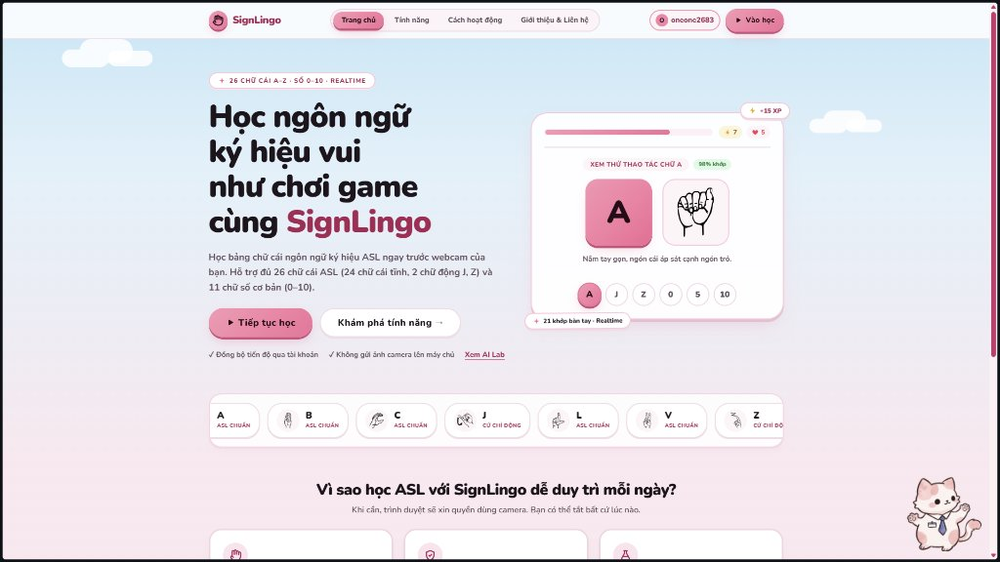 | 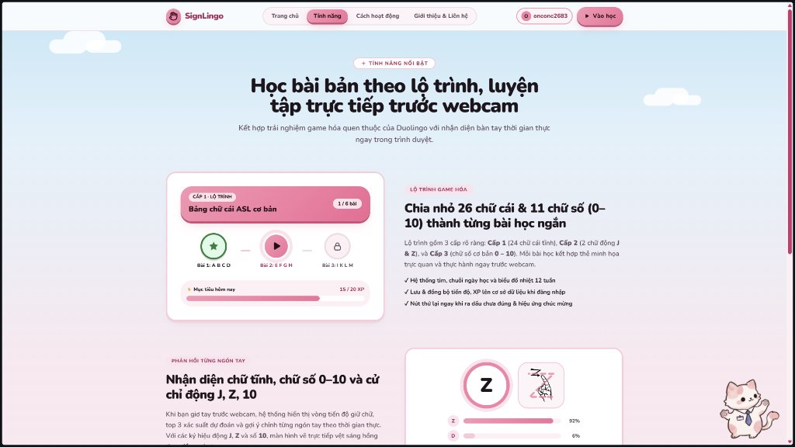 |
| Giới thiệu tổng quan, khung xem thử tương tác 26 chữ cái A–Z & chữ số 0–10 kèm dải ký hiệu ASL trực quan. | Minh họa lộ trình học game hóa theo cấp độ, nhận diện chữ tĩnh/động (`J`, `Z`, `10`) và phản hồi từng ngón tay. |

| Cách hoạt động & Quyền riêng tư (`/how-it-works`) | Giới thiệu & Nhóm phát triển (`/about`) |
|---|---|
| 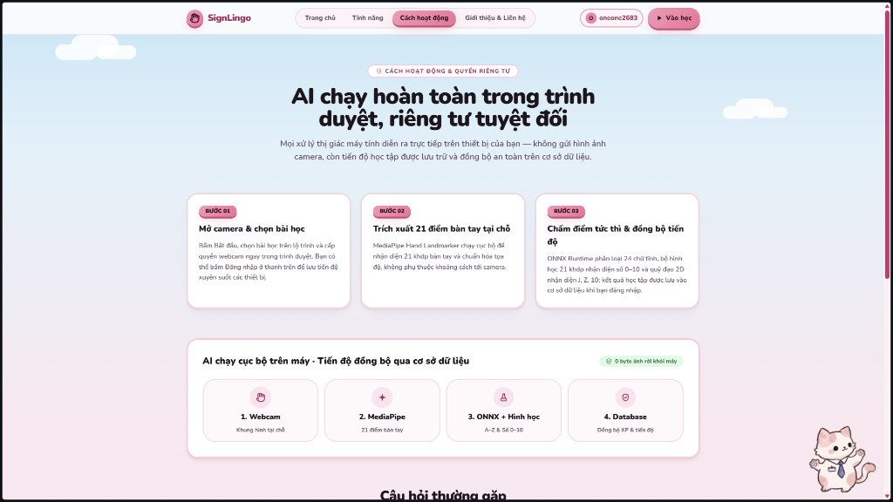 | 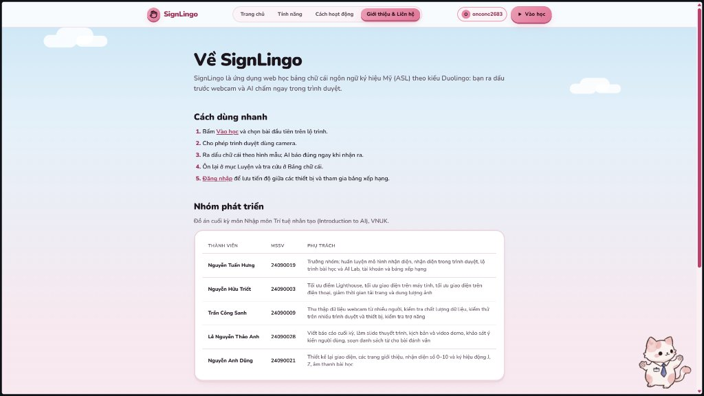 |
| Trình bày quy trình 3 bước và kiến trúc xử lý AI cục bộ (0 byte ảnh webcam rời khỏi máy), đồng bộ tiến độ qua cơ sở dữ liệu. | Hướng dẫn sử dụng nhanh trong 5 bước cùng thông tin phân công thành viên nhóm phát triển (VNUK). |

#### Ảnh chụp: học, luyện tập và AI Lab

| Lộ trình học (`/learn`) | Luyện tập tự do (`/practice`) |
|---|---|
| 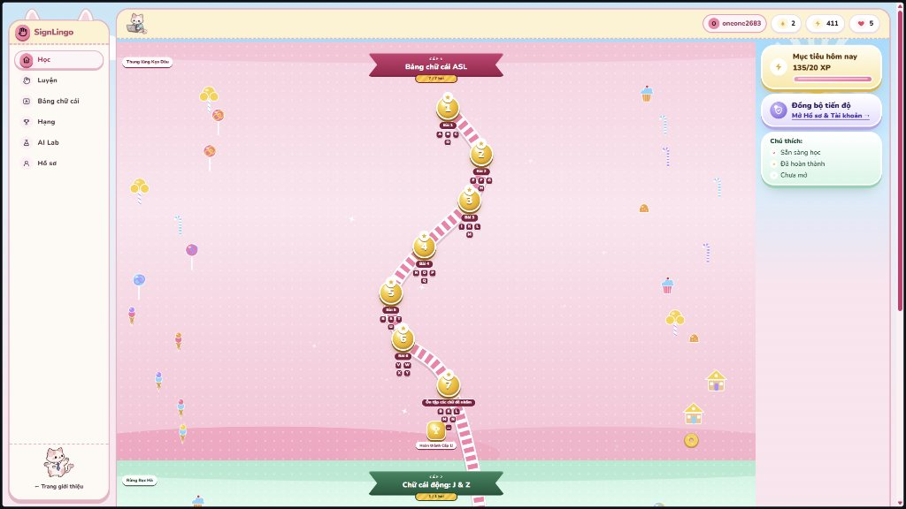 | 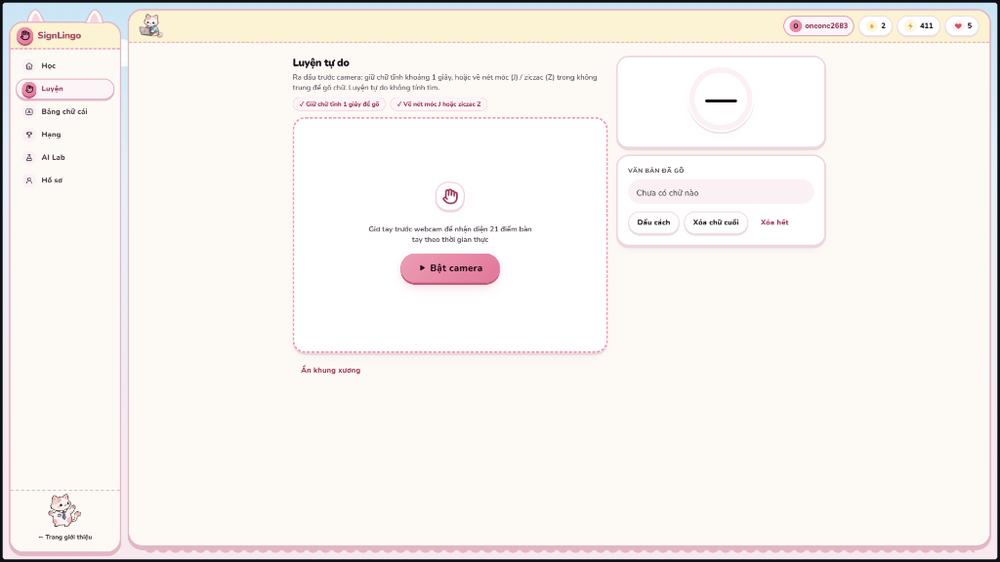 |
| Bản đồ lộ trình game hóa chia 3 cấp (chữ cái tĩnh, chữ động `J & Z`, chữ số `0–10`), theo dõi mục tiêu XP ngày, chuỗi ngày và tim. | Ra dấu tự do trước webcam để gõ chữ: giữ chữ tĩnh 1 giây hoặc vẽ nét `J`/`Z` trong không trung, không mất tim. |

| Bảng chữ cái & Chữ số (`/alphabet`) | Bảng xếp hạng (`/leaderboard`) |
|---|---|
| 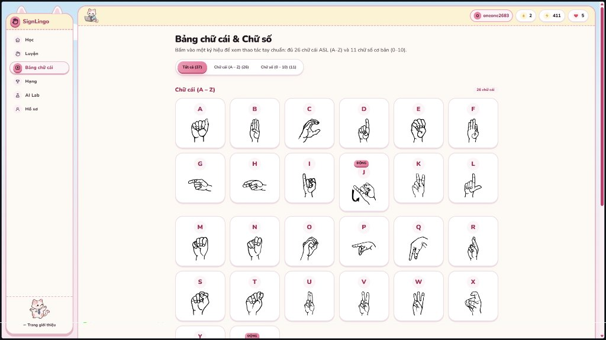 | 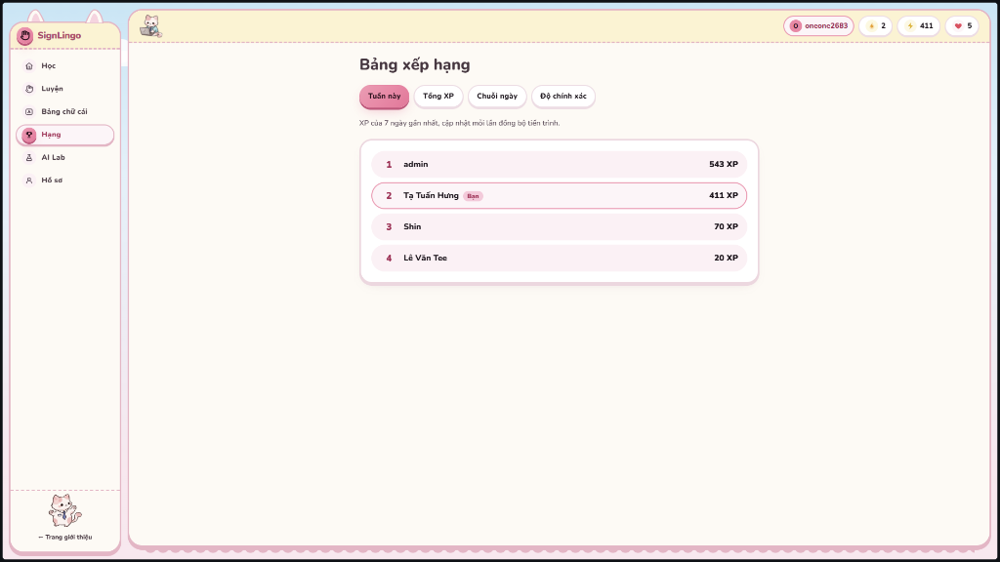 |
| Từ điển tra cứu nhanh đủ 26 chữ cái A–Z và 11 chữ số 0–10 với bộ lọc danh mục, hình minh họa dáng tay chuẩn và nhãn ký hiệu động. | Xếp hạng học viên đã đăng nhập và tham gia theo **Tuần này**, **Tổng XP**, **Chuỗi ngày** và **Độ chính xác**. |

| AI Lab — Phân tích lỗi (`/lab`) | Hồ sơ & Đồng bộ tài khoản (`/profile`) |
|---|---|
| 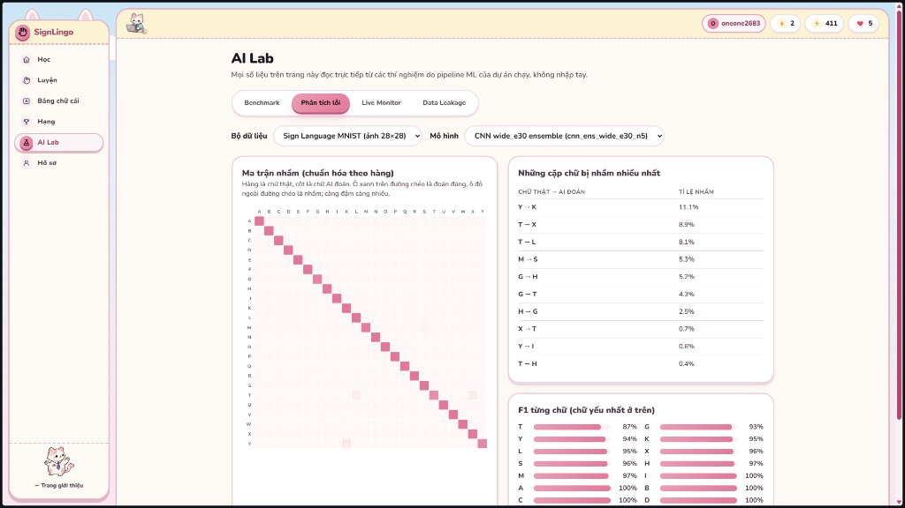 | 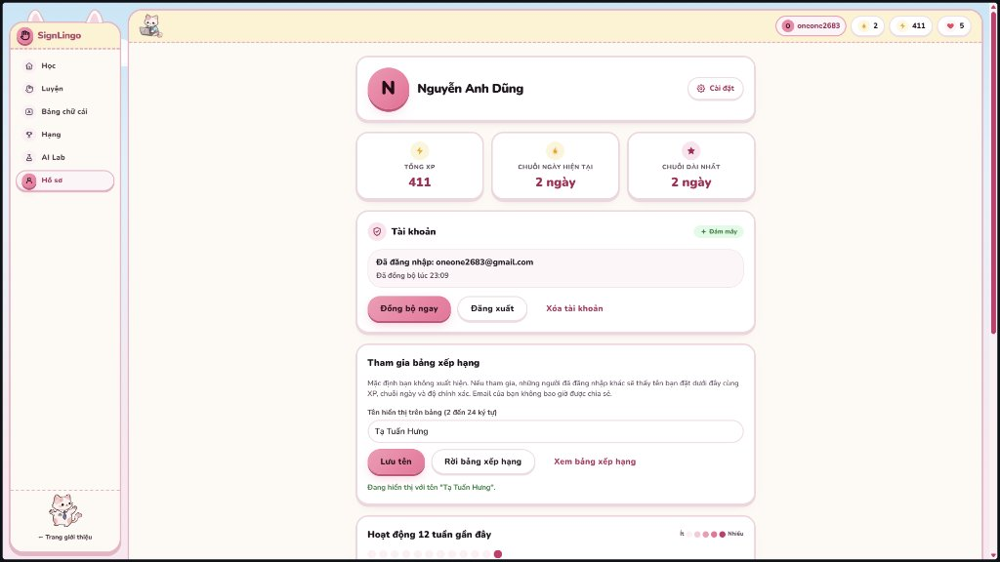 |
| Đọc trực tiếp kết quả thí nghiệm ML: bảng benchmark, ma trận nhầm lẫn chuẩn hóa, cặp chữ dễ nhầm, F1 từng chữ, kiểm tra data leakage và đo FPS thật. | Thống kê tổng XP, chuỗi ngày, đăng nhập/đồng bộ đám mây (Supabase), tùy chọn tham gia bảng xếp hạng và biểu đồ nhiệt 12 tuần. |

### (b) Sử dụng Tailwind CSS

- Tailwind CSS 4 qua plugin `@tailwindcss/vite`.
- Màu, cỡ chữ, bo góc, bóng và chuyển động là **design token** trong `frontend/src/styles/tokens.css`, đặc tả ở [`docs/05`](docs/05_UI_DESIGN_SPEC.md) §2. Component dùng token thay vì mã màu viết tay, nên đổi giao diện chỉ cần sửa token.
- Bố cục đáp ứng dùng breakpoint của Tailwind (ví dụ thanh điều hướng dưới màn hình chỉ hiện dưới `md`).

### (c) Các tính năng tương tác

- **Nhận diện thời gian thực:** ra dấu trước webcam, vòng tiến độ đầy khi giữ đúng khoảng 1 giây, có âm thanh báo đúng.
- **Gợi ý khi sai:** khi người học ra dấu gần với chữ khác, app gợi ý dựa trên các cặp chữ hay bị nhầm từ phân tích lỗi.
- **Bản đồ kẹo:** bấm vào viên kẹo bài học để xem thông tin và bắt đầu; bài sau mở khi học xong bài trước.
- **Trò chơi hóa:** XP, độ chính xác, chuỗi ngày học, mục tiêu hôm nay, linh vật mèo Lingo.
- **AI Lab:** chuyển tab, xem ma trận nhầm, đo tốc độ trực tiếp khi đang ra dấu.
- **Tài khoản:** đăng ký, đăng nhập, tự chọn có hiện trên bảng xếp hạng hay không, xóa tài khoản.

### (d) Giao diện trên nhiều thiết bị

- **Máy tính:** thanh điều hướng bên trái, lộ trình ở giữa, cột thông tin bên phải.
- **Điện thoại:** thanh điều hướng chuyển xuống đáy màn hình, khung camera co theo chiều ngang; giao diện được kiểm tra ở bề ngang 375 px.
- **Trợ năng:** dùng được bằng bàn phím, có nhãn cho trình đọc màn hình, kiểm tra tự động bằng axe-core (xem [Task 4](#kết-quả-kiểm-thử)).

---

## Task 3 — Database Integration & Dynamic Content

### (a) Thiết kế cơ sở dữ liệu

Cơ sở dữ liệu Postgres trên Supabase, tạo bằng [`supabase/migrations/`](supabase/migrations/). Chỉ lưu tiến độ học; không có bảng nào chứa ảnh hay tọa độ bàn tay.

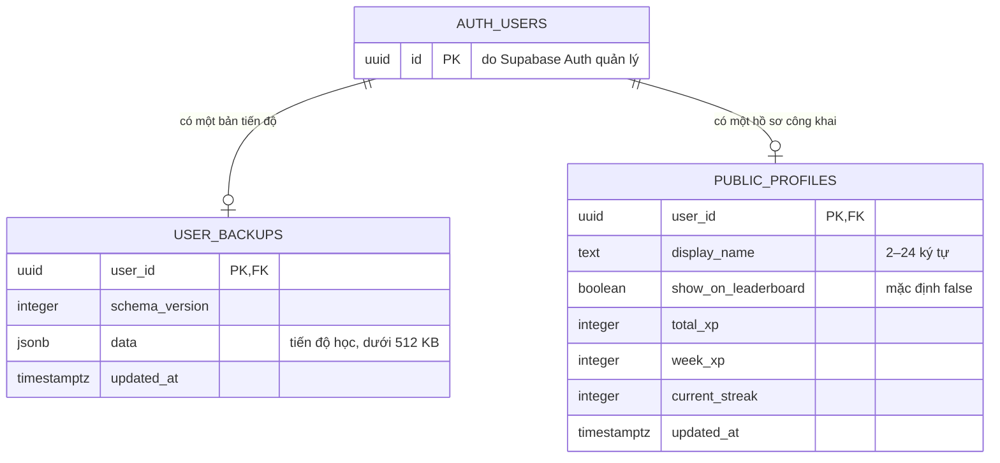

- **Row Level Security** bật trên cả hai bảng: mỗi người chỉ đọc và sửa dữ liệu của mình.
- **Điểm không do người dùng ghi:** người dùng chỉ được sửa `display_name` và `show_on_leaderboard`; `total_xp`, `week_xp`, `current_streak` do trigger `sync_scores` tính từ bản tiến độ, nên không thể tự sửa điểm.
- **Bảng xếp hạng** đọc qua hàm `get_leaderboard`, chỉ cho người đã đăng nhập và chỉ hiện người đã tự bật tham gia.
- Xóa tài khoản (`delete_my_account`) xóa luôn dữ liệu liên quan (`on delete cascade`).

Thiết kế: [`docs/03_DATA_STORAGE.md`](docs/03_DATA_STORAGE.md), [`docs/drafts/ADR_backend_sync_DRAFT.md`](docs/drafts/ADR_backend_sync_DRAFT.md).

### (b) Kết nối cơ sở dữ liệu

- Frontend dùng thư viện `@supabase/supabase-js` với URL và khóa công khai (anon) đọc từ biến môi trường `VITE_SUPABASE_*`. Khóa bí mật không bao giờ nằm trong frontend.
- Mã đồng bộ ở `frontend/src/sync/`: tiến độ lưu trước ở `localStorage` để app chạy được khi không có mạng, sau đó đồng bộ lên `user_backups` khi người học đăng nhập.
- Content Security Policy trên Vercel chỉ cho trang kết nối tới chính nó và Supabase.

### (c) Các trang hiển thị dữ liệu động

| Trang | Dữ liệu |
|---|---|
| `/leaderboard` | Xếp hạng theo XP tuần, tổng XP, chuỗi ngày, độ chính xác hoặc theo từng chữ, lấy từ hàm `get_leaderboard` |
| `/profile` | Thông tin tài khoản, trạng thái đồng bộ, tùy chọn hiện trên bảng xếp hạng |
| `/learn` | Bài đã học, bài đang mở, XP, chuỗi ngày, từ tiến độ đã lưu |
| `/lab` | 89 file kết quả thí nghiệm JSON và manifest mô hình do `ml/` sinh ra, không có số viết tay trong code |

---

## Task 4 — Optimization

### (a) Kiểm tra hiệu năng với Lighthouse

Đo trên bản production, trang lộ trình học https://signlingo-vn.vercel.app/learn, bằng Chrome DevTools → Lighthouse.

| Hạng mục | Máy tính | Điện thoại |
|---|---|---|
| Performance | **98** | **98** |
| Accessibility | **96** | **100** |
| Best Practices | **100** | **100** |
| SEO | **100** | **100** |
| Agentic Browsing | 3/3 | 3/3 |

| Chỉ số | Máy tính | Điện thoại |
|---|---|---|
| First Contentful Paint | 0,2 s | 0,9 s |
| Largest Contentful Paint | 0,5 s | 2,4 s |
| Total Blocking Time | 0 ms | 0 ms |
| Cumulative Layout Shift | 0,088 | 0 |
| Speed Index | 0,7 s | 1,2 s |

Lighthouse ghi rõ các giá trị này là ước tính và có thể thay đổi giữa các lần đo.

Các thay đổi đã làm để tăng điểm (task P5-21..P5-24):

- Trang sau trang chào **tải theo nhu cầu** (`React.lazy`), giảm JavaScript lúc mở trang.
- Bỏ script chặn hiển thị trong `index.html`; thêm thẻ meta mô tả.
- Ảnh linh vật chuyển sang **WebP**; ảnh và mô hình được cache 30 ngày.
- Thêm `robots.txt`, `sitemap.xml`, `llms.txt`, source map.
- Đường dẫn `/.well-known/*` không có file trả 404 thay vì trang HTML.

### (b) Theo dõi lỗi và hành vi người dùng

**App không dùng công cụ theo dõi bên thứ ba** (Sentry, Google Analytics…). Đây là lựa chọn có chủ đích: app xử lý hình camera, nên nhóm giữ nguyên tắc không gửi dữ liệu người học ra ngoài. Content Security Policy cũng chặn mọi kết nối ngoài Supabase. Thay vào đó, nhóm theo dõi lỗi và hành vi bằng:

- **CI trên mọi pull request:** lint, typecheck, test và build phải xanh trước khi merge.
- **Live Monitor trong AI Lab:** đo thời gian mỗi khung (p50, p95), thời gian bộ phân loại và số khung mỗi giây ngay trên máy người dùng; kết quả lưu thành file benchmark.
- **Kiểm thử đầu cuối** cho các luồng chính, quyền riêng tư (phiên camera chỉ gửi request tới chính trang) và trợ năng.
- **Xử lý lỗi trong app:** cảnh báo khi trình duyệt chặn lưu trữ, bản sao lưu hỏng bị từ chối mà không làm mất dữ liệu.
- **Tiến độ học** (độ chính xác từng chữ, chữ cần ôn) cho thấy người học hay gặp khó ở đâu; dữ liệu này nằm trên máy người học.

### Kết quả kiểm thử

Chạy ngày 2026-11-23 trên máy của nhóm (Windows 11):

| Bộ test | Kết quả |
|---|---|
| Frontend unit và component (Vitest) | **449/449 đạt**, 74 file |
| Frontend lint (ESLint) và typecheck (TypeScript) | Đạt, không lỗi |
| ML (pytest) | **185/185 đạt** |
| ML lint (ruff) | Đạt, không lỗi |
| E2E (Playwright, Chrome) | **20/20 đạt**, 5 file |

E2E gồm kiểm tra trợ năng bằng axe-core trên 8 trang (không lỗi WCAG AA), điều hướng chỉ bằng bàn phím, dữ liệu người học sau khi tải lại, bản sao lưu hỏng, lưu trữ bị chặn, cách ly cross-origin và quyền riêng tư của phiên camera. Lần chạy đầu sau đợt thiết kế lại giao diện phát hiện chữ logo có độ tương phản 4,33:1 (dưới 4,5:1 của WCAG AA); nhóm đã đổi màu thành 4,87:1.

---

## Deliverables Checklist

Nộp vào thư mục Google Drive của nhóm, chia sẻ với giảng viên.

- [x] Mã nguồn trên GitHub (repo này), kèm README
- [x] Báo cáo cuối kỳ theo mẫu IEEE: [`docs/final-report/`](docs/final-report/) (`.docx` và `.pdf`)
- [x] Báo cáo từng tuần (tuần 1–5): [`docs/weekly/`](docs/weekly/)
- [x] Bản chạy trên Vercel: https://signlingo-vn.vercel.app
- [ ] Slide thuyết trình từng tuần (nộp trên Drive)
- [ ] Video demo: kịch bản ở [`docs/08_DEMO_SCRIPT.md`](docs/08_DEMO_SCRIPT.md)
- [x] Điểm Lighthouse ở [Task 4 (a)](#a-kiểm-tra-hiệu-năng-với-lighthouse)
- [ ] Bản tự nhìn lại cá nhân viết tay (5 thành viên)

---

## Self-Reports

| Tuần | Nội dung | File |
|---|---|---|
| 1 | SWOT, kế hoạch liên lạc, tổng quan dự án, WBS, cấu trúc GitHub | [BaoCao_Tuan1](docs/weekly/BaoCao_Tuan1_SignLingo.docx) |
| 2 | Định nghĩa bài toán, 3 câu hỏi nghiên cứu, khám phá và chất lượng dữ liệu | [BaoCao_Tuan2](docs/weekly/BaoCao_Tuan2_SignLingo.docx) |
| 3 | Tiền xử lý, chia dữ liệu, đặc trưng, lý do chọn mô hình, baseline | [BaoCao_Tuan3](docs/weekly/BaoCao_Tuan3_SignLingo.docx) |
| 4 | Kiến trúc, huấn luyện, chỉ số, so sánh, phân tích lỗi | [BaoCao_Tuan4](docs/weekly/BaoCao_Tuan4_SignLingo.docx) |
| 5 | Tích hợp cuối, demo pipeline, tổng kết, hạn chế, hướng phát triển | [BaoCao_Tuan5](docs/weekly/BaoCao_Tuan5_SignLingo.docx) |

Mỗi báo cáo gồm 8 mục: What, When, Why, Who, How much, rủi ro, thay đổi, vấn đề. Bản tự nhìn lại cá nhân (đánh giá dự án, chia 100 đồng vàng cho thành viên, Document Quality Statement) là bản viết tay, nộp riêng.

---

## Thông tin bổ sung

### Triển khai hệ thống

- **Frontend:** Vercel, build bằng `pnpm build` trong `frontend/`. [`frontend/vercel.json`](frontend/vercel.json) chuyển mọi đường dẫn về `index.html` (trừ thư mục mô hình, dữ liệu, ảnh, âm thanh), đặt header COOP/COEP để chạy ONNX Runtime đa luồng, Content Security Policy và cache.
- **Backend:** Supabase (Auth + Postgres). Chạy SQL trong `supabase/migrations/` một lần trên dashboard; hướng dẫn ở [`supabase/README.md`](supabase/README.md).
- **Mô hình:** `ml/` xuất file ONNX và JSON thí nghiệm vào `frontend/public/`, deploy cùng trang tĩnh.

### Tài liệu dự án

| Tài liệu | Nội dung |
|---|---|
| [01 PRD](docs/01_PRD.md) | Yêu cầu sản phẩm, tiêu chí chấp nhận |
| [02 Kiến trúc](docs/02_SOLUTION_ARCHITECTURE.md) | Kiến trúc, lựa chọn công nghệ |
| [03 Dữ liệu và lưu trữ](docs/03_DATA_STORAGE.md) | Dữ liệu người học, đồng bộ |
| [04 Hợp đồng dữ liệu](docs/04_CONTRACTS.md) | Định dạng JSON giữa `ml/` và `frontend/` |
| [05 Thiết kế giao diện](docs/05_UI_DESIGN_SPEC.md) | Token, component, wireframe |
| [07 Master Plan](docs/07_MASTER_PLAN.md) | Task, trạng thái, phân công |
| [08 Kịch bản demo](docs/08_DEMO_SCRIPT.md) | Kịch bản trình bày |
| [Kết quả ML](ml/reports/RESULTS.md) | Trả lời 3 câu hỏi nghiên cứu |

### Ghi chú

**Giới hạn hiện tại:**

- Chưa đo độ chính xác trên người ra dấu mới: dữ liệu không có cột người ra dấu, chưa thu webcam nhiều người.
- Dữ liệu chữ X lệch dáng chuẩn (ngón trỏ thẳng thay vì cong); chữ U hay bị nhận thành R.
- Số 0–10 và J, Z dùng luật hình học, chưa có thí nghiệm đo độ chính xác.
- Chưa đạt 30 khung/giây trên laptop của nhóm; mới đo một lần trên một máy.
- Ngưỡng chấm đúng 0,60 và thời gian giữ 1 giây là giả thuyết khởi đầu.

**Giấy phép:** [MIT](LICENSE). Các bộ dữ liệu (Sign Language MNIST, `keypoint.csv`) và thư viện bên thứ ba giữ giấy phép riêng của tác giả gốc.
