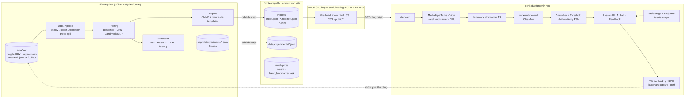
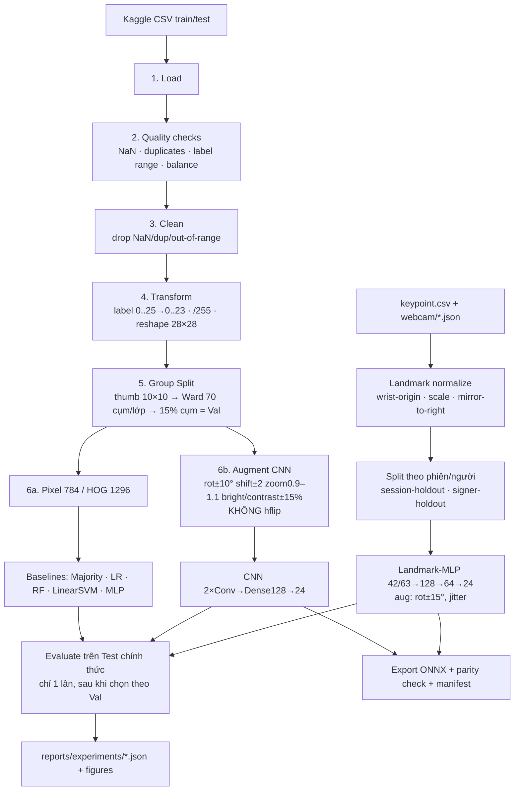
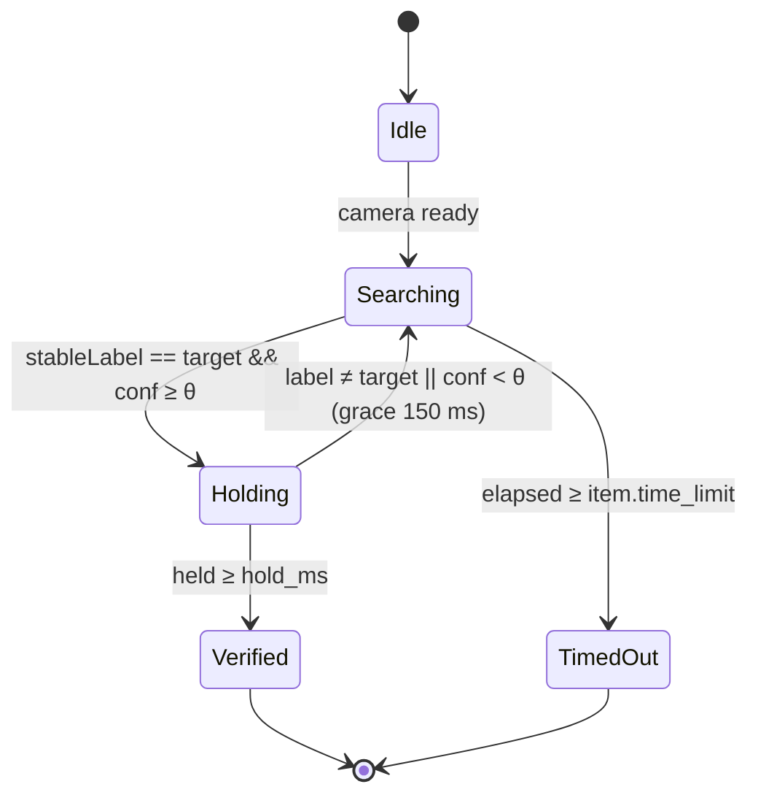

# 02 — Solution Architecture: SignLingo AI

> **Trạng thái:** Draft v0.2 — chờ review · **Ngày:** 2026-11-18 · **v0.2:** bỏ backend; SPA tĩnh trên Vercel; dữ liệu người học trong trình duyệt
> Truy vết: mã `FT-*` / `AC-*` tham chiếu [01_PRD](01_PRD.md).

---

## 1. Nguyên tắc kiến trúc

| # | Nguyên tắc | Hệ quả |
|---|---|---|
| A1 | **Inference ở client (Edge AI)** | Video không rời trình duyệt (AC-PRIV-01), không tốn server, độ trễ thấp |
| A2 | **2 khối độc lập: `ml/` (Python, offline) · `frontend/` (SPA)** | Chỉ giao tiếp qua *hợp đồng* trong `shared/contracts/` (JSON Schema manifest, experiment, curriculum, fixture landmark). Không import chéo mã nguồn |
| A3 | **Mô hình là artifact có phiên bản** | Mỗi lần export sinh `model.onnx` + `manifest.json` (sha256, labels, preprocess_version). Frontend chỉ đọc manifest |
| A4 | **Tái lập (Reproducibility) là yêu cầu chức năng** | seed 42, config YAML, 1 lệnh chạy, log thí nghiệm JSON được commit |
| A5 | **Không backend (quyết định 2026-11-18)** | Toàn bộ app là file tĩnh trên Vercel. Tiến độ, XP, streak, hearts tính bằng module TS thuần và lưu trong trình duyệt; sao lưu bằng Xuất/Nhập JSON |
| A6 | **Tiền xử lý một nguồn, hai hiện thực có kiểm chứng** | Landmark normalization viết ở Python & TS, khóa bằng golden fixture (AC-ML-09) |
| A7 | **Không gọi mạng ra ngoài origin** | MediaPipe wasm/`.task`, model, dữ liệu AI Lab đều tự host; không CDN bên thứ ba lúc chạy |

## 2. Tổng quan hệ thống (C4 – Container)



## 3. Tech Stack & Quyết định (ADR tóm tắt)

| Lớp | Lựa chọn | Lý do | Phương án bị loại |
|---|---|---|---|
| ML ngôn ngữ | **Python 3.11** | Hệ sinh thái ML, yêu cầu môn | — |
| ML framework | **PyTorch 2.x** (CNN, Landmark-MLP, Sequence model) + **scikit-learn** (baseline, HOG via scikit-image) | Export ONNX chuẩn; bản NumPy tuần 4 giữ làm tham chiếu kiểm chứng | TensorFlow.js training (khó tái lập, khó so sánh với sklearn) |
| Định dạng mô hình web | **ONNX** (opset 17) chạy bằng **onnxruntime-web** (WebGPU → WASM SIMD fallback) | 1 định dạng cho cả CNN & MLP; quantize int8 được | TF.js (phải convert 2 bước) |
| Quản lý môi trường ML | **uv** + `pyproject.toml`, khóa `uv.lock` (tạm thời đang dùng `venv` + `pip` vì máy chưa cài uv) | Nhanh, tái lập | conda (nặng) |
| Thí nghiệm | Config YAML + log JSON trong `reports/experiments/` (commit vào git) | Nhẹ, người chấm đọc được, AI Lab đọc trực tiếp | MLflow (thừa cho quy mô đồ án) |
| Hand tracking | **`@mediapipe/tasks-vision` HandLandmarker** (runningMode `VIDEO`, delegate `GPU`), tự host | Nhanh hơn đáng kể so với `@mediapipe/hands` legacy (nguyên nhân chính ~10 FPS tuần 4) | Legacy MediaPipe Hands |
| Frontend | **React 19 + TypeScript 6 + Vite** | Phổ biến, hệ sinh thái skill/AI agent tốt; TS ghim 6.x vì typescript-eslint chưa hỗ trợ TS 7 | Next.js (không cần SSR; SPA đủ) |
| Styling | **Tailwind CSS 4** + CSS variables (design tokens) + **Radix UI primitives** | Dark mode bằng biến; a11y sẵn có | MUI (khó đạt look Duolingo) |
| State | **Zustand** (session học, camera, UI) + `src/storage/` (persist có version) | Đơn giản, test được | Redux; TanStack Query (không còn server state) |
| Lưu trữ người học | **localStorage** (< 1 MB, có `schema_version` + migrate) qua adapter; IndexedDB nếu sau này cần lưu nhiều hơn | Không cần server; Xuất/Nhập JSON để sao lưu | Backend + DB (đã bỏ) |
| Animation/âm thanh | Framer Motion · Howler.js · canvas-confetti | Hiệu ứng kiểu game | — |
| Biểu đồ AI Lab | Recharts (bar/line) + heatmap tự vẽ SVG cho Confusion Matrix 24×24 | Nhẹ | Plotly (nặng) |
| Routing | React Router (SPA, rewrite mọi path về `index.html` trên Vercel) | | |
| Test | ML: pytest + hypothesis · FE: Vitest + Testing Library · E2E: **Playwright** (Chrome fake camera) | Phủ 3 lớp test | Cypress (fake camera kém hơn) |
| Hosting | **Vercel Hobby** (static, HTTPS, CDN, Preview cho mỗi PR) | Miễn phí cho dự án phi thương mại; camera cần HTTPS | Render/Railway (không cần server) |
| CI | GitHub Actions (lint + test `ml/`, `frontend/`, e2e smoke); Vercel tự build & deploy | | |

## 4. AI Pipeline (Python → ONNX → Web)

### 4.1 Luồng dữ liệu huấn luyện



### 4.2 Quy tắc chống rò rỉ dữ liệu (bắt buộc — AC-ML-02/03)

1. `split.py` là nơi **duy nhất** tạo split; lưu `data/processed/split_v{n}.parquet` gồm `row_id, label, group_id, split`.
2. Mọi transformer có `fit` (StandardScaler, PCA…) chỉ được fit trong hàm nhận `train_df`; test lint bằng unit test kiểm tra thống kê.
3. Tập test chính thức chỉ được đọc trong `evaluate.py --final`; mọi script tuning bị chặn đọc test (assert).
4. Dữ liệu landmark: không chia ngẫu nhiên theo mẫu — chia theo `session_id` (20% phiên cuối mỗi lớp) và báo cáo thêm `signer_id` holdout.
5. Báo cáo **Leakage Study**: random split vs group split cho cùng mô hình (AI Lab FT-LAB-04).

### 4.3 Hai mô hình phục vụ web

| | CNN (ảnh) | Landmark-MLP (mặc định cho web) |
|---|---|---|
| Input | Crop vùng tay từ bbox MediaPipe → grayscale 28×28 | 21 điểm → chuẩn hóa → **42 số (x, y) mặc định** vì `keypoint.csv` không có z; bản 63 số (x, y, z) chỉ thử khi đủ dữ liệu webcam tự thu — chọn theo Val |
| Ưu | Accuracy Kaggle 97,7% | Bền với nền/ánh sáng/màu da, < 1 ms |
| Nhược | Domain gap lớn với webcam | R/U, N/M khó trên 2D |
| Vai trò | Benchmark học thuật + chế độ "Ensemble" thử nghiệm trong AI Lab | Chạy trong Lesson Player |

**Landmark normalization (spec dùng chung Python & TS, `preprocess_version = "lm-v1"`):**
1. Nếu `handedness == Left` và setting `mirror_left = true` → lật `x := 1 − x` (đưa về tay phải).
2. Tịnh tiến: `p_i := p_i − p_0` (cổ tay là gốc).
3. Chuẩn hóa tỉ lệ: chia cho `max_i ‖p_i[x,y]‖` (khoảng cách xa nhất tới cổ tay trên mặt phẳng xy); z chia cùng hệ số.
4. Flatten theo thứ tự landmark 0..20 → `Float32Array(42)` cho `features = "xy"` hoặc `Float32Array(63)` cho `"xyz"` (manifest quyết định).
5. Golden fixture: `shared/contracts/fixtures/landmarks_lm-v1.json` (input thô, output kỳ vọng) — sinh bởi Python, test ở cả 2 phía.

### 4.4 Model Manifest (hợp đồng ML → Web)

`shared/contracts/schemas/model_manifest.schema.json`, ví dụ:

```json
{
  "model_id": "landmark-mlp",
  "version": "1.2.0",
  "task": "static_letters",
  "file": "landmark-mlp-1.2.0.onnx",
  "sha256": "…",
  "input": { "name": "x", "shape": [1, 42], "dtype": "float32", "features": "xy" },
  "output": { "name": "logits", "shape": [1, 24] },
  "labels": ["A","B","C","D","E","F","G","H","I","K","L","M","N","O","P","Q","R","S","T","U","V","W","X","Y"],
  "preprocess_version": "lm-v1",
  "recommended": { "threshold": 0.6, "hold_ms": 1000, "smoothing_window": 5 },
  "class_templates": { "A": { "finger_angles": [/* 15 góc khớp, độ */] } },
  "metrics": { "val_macro_f1": 0.0, "test_macro_f1": 0.0, "signer_holdout_macro_f1": 0.0 },
  "trained_at": "ISO-8601", "git_commit": "…", "seed": 42
}
```

## 5. Luồng thời gian thực (Webcam → MediaPipe → Inference → UI)

### 5.1 Sequence

```mermaid
sequenceDiagram
  participant V as <video> (getUserMedia 640×480@30)
  participant L as FrameLoop (requestVideoFrameCallback)
  participant MP as HandLandmarker (GPU)
  participant N as Normalizer lm-v1
  participant C as Classifier (ORT-web)
  participant S as Smoother + HoldFSM
  participant U as React UI (Zustand store)

  V->>L: new frame (t)
  L->>MP: detectForVideo(frame, t)
  MP-->>L: 21 landmarks + handedness (hoặc none)
  alt không thấy tay
    L->>S: reset(no_hand)
  else có tay
    L->>N: normalize(landmarks)
    N->>C: Float32[63]
    C-->>L: logits → softmax(24)
    L->>S: push(probs, t)
    S-->>U: {topK, stableLabel, holdProgress 0..1, fingerDiff}
  end
  L->>U: perf sample (mp_ms, cls_ms, fps)
  Note over U: UI chỉ re-render ≤ 30 lần/s; overlay vẽ trên canvas riêng ngoài React
```

### 5.2 Hold-to-Verify FSM (FT-LRN-03)



- `stableLabel` = nhãn có xác suất trung bình cao nhất trên cửa sổ trượt `smoothing_window` khung (EMA α≈0,4 thay thế được).
- Grace period 150 ms tránh reset vì 1–2 khung nhiễu.

### 5.3 Phản hồi sửa lỗi ngón tay (FT-LRN-04)

1. Tính 15 góc gập khớp (5 ngón × 3 khớp: MCP, PIP, DIP; ngón cái: CMC, MCP, IP) từ landmark đã chuẩn hóa (2D theo `keypoint.csv`; nâng lên 3D khi có template từ dữ liệu xyz).
2. So với `class_templates[target]` (trung bình + độ lệch chuẩn tính từ train set ở Python).
3. Ngón có |Δ| > `k·σ` (k = 2, tối thiểu 20°) → tô đỏ trên overlay + gợi ý: "Gập ngón trỏ nhiều hơn" / "Duỗi ngón cái".
4. Nếu top-1 là chữ nằm trong danh sách cặp nhầm (từ Confusion Matrix) → hiển thị "Đang giống chữ **S** — khác ở vị trí ngón cái".

### 5.4 Chiến lược đạt > 30 FPS (RQ3, AC-PERF-01)

| # | Kỹ thuật | Kỳ vọng |
|---|---|---|
| 1 | Chuyển sang `tasks-vision` HandLandmarker, delegate GPU, `numHands: 1` | Bỏ nút cổ chai chính (~10 → 30+ FPS) |
| 2 | Input camera 640×480 (không 1080p); `requestVideoFrameCallback` thay `setInterval` | Không xử lý khung trùng |
| 3 | Overlay vẽ trên `<canvas>` trực tiếp, không qua React state; React chỉ nhận state đã throttle | Giảm jank main thread |
| 4 | ORT-web: tái sử dụng session & tensor; WASM SIMD + threads (cần header COOP/COEP) hoặc WebGPU | Classifier < 1 ms |
| 5 | (Phase 4) Chạy MediaPipe + ORT trong **Web Worker** với `OffscreenCanvas`/`ImageBitmap` | Main thread rảnh cho UI |
| 6 | Quantize int8 nếu cần (đo lại Macro-F1, chấp nhận giảm ≤ 0,005) | Tải nhanh hơn |
| 7 | Đo bằng `PerfMonitor`: tách `capture_fps`, `mp_ms`, `cls_ms`, `frame_total_ms` p50/p95; mục tiêu **frame_total p50 ≤ 33 ms, p95 ≤ 40 ms** (AC-PERF-01) | Bằng chứng RQ3 cho báo cáo |

## 6. Lớp dữ liệu phía client (thay cho Backend)

Chi tiết lược đồ ở [03_DATA_STORAGE](03_DATA_STORAGE.md), interface ở [04_CONTRACTS](04_CONTRACTS.md) §6.

```
frontend/src/
  storage/   # adapter localStorage: get/set có try/catch, schema_version, migrate, export/import
  game/      # hàm thuần: computeXp, applyHeartRegen, applyDailyXp (streak), lessonStatus
  content/   # curriculum.json (nội dung do nhóm duyệt) + loader có kiểm schema
```

Quy tắc:
- Component **không** gọi `localStorage` trực tiếp; chỉ dùng `LearnerStore`.
- `src/game/*` không biết DOM hay storage; nhận `now` làm tham số để test được múi giờ/qua đêm.
- `completeSession` idempotent theo `session.id`.
- Bộ quy tắc XP/hearts/streak mặc định ở 03 §3.5 (cần duyệt số liệu).

## 7. Bảo mật & Quyền riêng tư

- Không có server nhận dữ liệu → không dữ liệu nào của người học rời trình duyệt, trừ khi chính họ tải file xuống (backup, mẫu landmark, benchmark).
- Không cookie, không analytics, không CDN bên thứ ba lúc chạy (A7) → không cần banner cookie.
- Camera chỉ chạy trong secure context: Vercel luôn HTTPS; dev dùng `localhost`.
- Header bảo mật trong `vercel.json`: `Content-Security-Policy` (chỉ `'self'`, thêm `'wasm-unsafe-eval'` cho WASM), `Cross-Origin-Opener-Policy: same-origin`, `Cross-Origin-Embedder-Policy: require-corp` (bật WASM threads), `Permissions-Policy: camera=(self)`.
- Trang `/collect` dùng mã người ra dấu ẩn danh (S01…), không hỏi tên thật.
- Không có secrets trong repo (không còn backend → không cần `.env` cho runtime).

## 8. Cấu trúc Monorepo

```
SignLingo/
├── CLAUDE.md · README.md
├── docs/                         # 01–07 + course/ + reports/
├── shared/contracts/
│   ├── schemas/                  # model_manifest, model_index, experiment, experiment_index,
│   │                             # curriculum, backup, landmark_capture (.schema.json)
│   └── fixtures/landmarks_lm-v1.json
├── ml/
│   ├── CLAUDE.md · pyproject.toml
│   ├── configs/                  # *.yaml cho từng thí nghiệm
│   ├── src/signlingo_ml/
│   │   ├── config.py  data/  features/  models/  train/  evaluate/  export/  landmarks/
│   │   └── pipeline.py           # python -m signlingo_ml.pipeline all
│   ├── tests/  (unit/ integration/ e2e/)
│   ├── data/   (raw/, processed/ — gitignored)
│   ├── artifacts/                # gitignored
│   └── reports/ (experiments/*.json, figures/, perf/ — commit)
├── frontend/
│   ├── CLAUDE.md · package.json · vite.config.ts · vercel.json
│   ├── public/
│   │   ├── models/ (index.json, *.manifest.json, *.onnx)     # do ml publish
│   │   ├── data/experiments/ (index.json, <run_id>.json)    # do ml publish
│   │   ├── mediapipe/ (wasm/, hand_landmarker.task)          # script fetch-mediapipe
│   │   └── media/ · sounds/                                  # do nhóm cung cấp
│   └── src/
│       ├── app/ (router, providers)  pages/  components/ui/
│       ├── features/ (lesson, skill-tree, practice, lab, profile, settings, collect)
│       ├── vision/ (camera, landmarker, normalizer, classifier, smoother, holdFsm, fingerFeedback, perf, engine)
│       ├── storage/  game/  content/
│       └── styles/ (tokens.css)
├── e2e/  (Playwright, fixtures/video/*.y4m)
└── .github/workflows/ci.yml
```

## 9. Triển khai (Vercel)

| Mục | Cấu hình |
|---|---|
| Project | 1 project Vercel, **Root Directory = `frontend/`**, Framework preset Vite, build `pnpm build`, output `dist/` |
| Nhánh | `main` → Production; mỗi PR → Preview URL (dùng để review UI/E2E) |
| SPA routing | `vercel.json` rewrite `/(.*)` → `/index.html` (trừ file tĩnh) |
| Headers | COOP/COEP/CSP/Permissions-Policy (§7); cache `immutable` cho `/models/*.onnx`, `/models/*.manifest.json`, `/mediapipe/*`; `max-age=300` cho `index.json` |
| Dung lượng | Model landmark vài trăm KB, CNN ~1 MB, MediaPipe (wasm + `.task`) khoảng vài chục MB → nằm trong giới hạn file tĩnh; kiểm lại giới hạn hiện hành của gói Hobby khi tạo project |
| Nhóm | Gói Hobby do **một người** làm chủ project. Với repo private, deploy từ commit của thành viên khác có thể bị chặn → để repo public (rubric cũng chấm GitHub) hoặc chủ project merge PR |
| Dev cục bộ | `pnpm dev` (Vite cũng đặt COOP/COEP để khớp production) · `pnpm preview` trước khi deploy |
| Demo dự phòng | Nếu mạng lớp học yếu: `pnpm build && pnpm preview` trên laptop (localhost vẫn là secure context) |

## 10. Truy vết Feature → Thành phần

| Feature | ML | Frontend |
|---|---|---|
| FT-ML-01..07 | `ml/src/signlingo_ml/*` | AI Lab đọc `public/data/` |
| FT-LRN-02/03 | export manifest (`recommended`) | `features/lesson`, `vision/holdFsm` |
| FT-LRN-04 | `class_templates`, `confusable` | `vision/fingerFeedback` |
| FT-GAM-* | — | `game/*`, `storage/*`, TopBar, ResultScreen |
| FT-ACC-02..04 | — | `storage/*`, `features/settings` |
| FT-SYS-01 | export/publish | `vision/classifier` loader |
| FT-SYS-02 | `landmarks/ingest.py` | `features/collect` (tải file) |
| FT-LAB-* | reports JSON + publish | `features/lab` |
