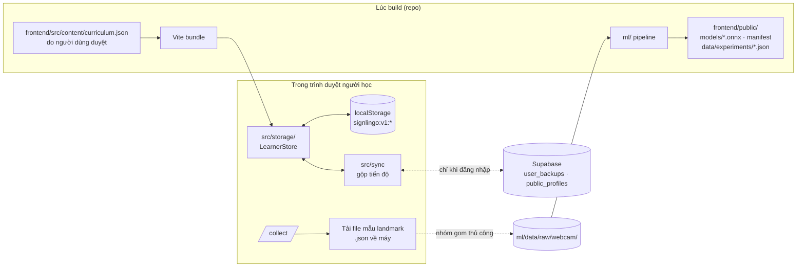
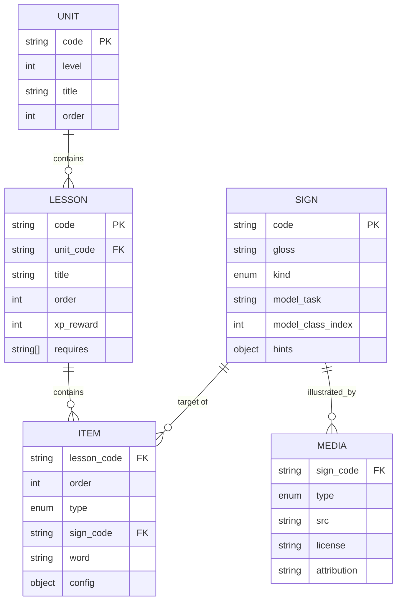

# 03 — Data & Storage: SignLingo AI

> **Trạng thái:** v0.4 · **Ngày:** 2026-11-23 · **v0.3 (đồng bộ với code):** thêm §6 tài khoản, đồng bộ và bảng xếp hạng qua Supabase (tùy chọn); bỏ Xuất JSON; thêm ký hiệu số và chữ động. · **v0.4 (2026-11-23, đồng bộ với code):** `/` luôn hiện trang chào (`onboarded` chỉ đổi chữ nút).
> **Thay thế** `03_DATABASE_SCHEMA.md` (v0.1). Backend là Supabase (không tự viết server). Dữ liệu chia thành 4 loại: (1) **nội dung tĩnh** đóng gói cùng app, (2) **dữ liệu người học** lưu trong trình duyệt, (3) **bản sao tiến độ trên Supabase** khi người học tự đăng nhập (tùy chọn, §6), (4) **dữ liệu ML** sinh offline bởi `ml/`.
> Truy vết: [01_PRD](01_PRD.md) §5 · [04_CONTRACTS](04_CONTRACTS.md)

---

## 1. Tổng quan



| Loại | Lưu ở đâu | Ai ghi | Ghi chú |
|---|---|---|---|
| Nội dung học (units, lessons, items, signs) | `frontend/src/content/curriculum.json` (+ media trong `public/media/`) | Nhóm (qua PR) | **Nội dung do người dùng cung cấp/duyệt**, không tự sinh |
| Tiến độ, XP, streak, hearts, cài đặt | `localStorage` (khóa `signlingo:v1:*`) | App | Mất khi xóa dữ liệu trình duyệt, trừ khi người học đăng nhập để đồng bộ (§6) |
| Bản sao tiến độ (tùy chọn) | Supabase `user_backups` (một dòng JSON mỗi tài khoản) | App, khi đã đăng nhập | Chỉ `profile, stats, progress, daily, sign_stats` |
| Điểm bảng xếp hạng (tùy chọn) | Supabase `public_profiles` | Trigger trong DB | Chỉ khi người học tự bật tham gia |
| Lịch sử phiên & benchmark FPS | `localStorage` (giới hạn N bản ghi gần nhất) | App | Ở lại máy, không đồng bộ |
| Mẫu landmark thu thêm | **File tải về**, không lưu trên server | Người thu | Nhóm chép vào `ml/data/raw/webcam/` |
| Mô hình, manifest, kết quả thí nghiệm | `frontend/public/models/`, `frontend/public/data/` | `ml/` publish script | File tĩnh, cache theo version |

## 2. Nội dung tĩnh: `curriculum.json`

Schema: `shared/contracts/schemas/curriculum.schema.json` (kiểm bằng test khi build).



| Trường | Ràng buộc |
|---|---|
| `unit.level` | 1 = Bảng chữ cái, 2 = Fingerspelling, 3 = Từ vựng (COULD) |
| `lesson.requires` | Danh sách `lesson.code` phải hoàn thành để mở; rỗng = mở mặc định |
| `item.type` | `learn_card` · `perform_sign` · `choose_sign` · `spell_word` · `perform_dynamic` (curriculum hiện dùng `learn_card`, `perform_sign`, `perform_dynamic`) |
| `sign.kind` / `model_task` | `static` + `static_letters` (24 chữ, mô hình ONNX) · `static` + `numbers` (0–9, luật hình học) · `dynamic` + `dynamic_letters` (J, Z) · `dynamic` + `numbers` (10) |
| `item.sign_code` | Bắt buộc với mọi type trừ `spell_word` |
| `item.word` | Bắt buộc với `spell_word`; chỉ gồm chữ có trong `labels` của mô hình active |
| `item.config` | `{ hold_ms?, threshold?, time_limit_ms? }` — mặc định lấy từ `manifest.recommended` |
| `sign.model_class_index` | Phải khớp vị trí trong `manifest.labels` (kiểm ở test) |
| `media.license`, `attribution` | Bắt buộc |

`signs` cho 24 chữ tĩnh được **suy ra từ label map** (`ml/config.py`), không phải dữ liệu tự bịa. Hiện có 37 ký hiệu (24 chữ tĩnh, J, Z, số 0–10) trong 3 unit: U1 Bảng chữ cái ASL (7 bài), U2 Chữ cái động J & Z (1 bài), U3 Chữ số cơ bản 0–10 (2 bài). Danh sách từ cho `spell_word` vẫn **chờ người dùng cung cấp**.

## 3. Dữ liệu người học trong trình duyệt

### 3.1 Nguyên tắc
- Mọi truy cập qua module `src/storage/` (adapter), **không gọi `localStorage` trực tiếp** trong component.
- Mọi đọc/ghi bọc `try/catch`; khi storage không dùng được (chế độ riêng tư, bị chặn) → chạy bằng bộ nhớ tạm và hiện banner "Tiến độ sẽ không được lưu".
- Mỗi khóa có `schema_version`; khi đổi cấu trúc phải viết hàm `migrate(vN → vN+1)` kèm unit test.
- Không lưu ảnh/video. Không lưu thông tin định danh ngoài tên hiển thị (tùy chọn).
- Dung lượng mục tiêu < 1 MB; lịch sử phiên giữ tối đa 200 bản ghi, benchmark tối đa 20.

### 3.2 Lược đồ khóa (`schema_version = 1`)

| Khóa | Kiểu | Nội dung |
|---|---|---|
| `signlingo:v1:profile` | `Profile` | `{ display_name?: string, created_at: ISO, timezone: IANA }` |
| `signlingo:v1:settings` | `Settings` | `{ theme: 'system'\|'light'\|'dark' (vẫn lưu nhưng app luôn hiển thị sáng), handedness: 'right'\|'left', sound_on: bool, reduced_motion: 'system'\|'on'\|'off', daily_xp_goal: 10\|20\|30\|50, camera_device_id?: string }` |
| `signlingo:v1:stats` | `Stats` | `{ total_xp, current_streak, longest_streak, last_goal_date: 'YYYY-MM-DD'\|null, hearts: 0..5, hearts_updated_at: ISO }` |
| `signlingo:v1:progress` | `Record<lesson_code, LessonProgress>` | `{ status: 'completed'\|'in_progress', best_accuracy_pct, times_completed, last_completed_at }` (trạng thái `locked/available` **tính ra** từ `requires`, không lưu) |
| `signlingo:v1:daily` | `Record<'YYYY-MM-DD', DailyActivity>` | `{ xp_earned, lessons_completed, goal_met }` — giữ 120 ngày gần nhất |
| `signlingo:v1:sessions` | `SessionRecord[]` | Xem §3.3 |
| `signlingo:v1:sign_stats` | `Record<sign_code, SignStat>` | `{ attempts, correct, avg_time_to_verify_ms }` — cho mục "Chữ cần ôn" |
| `signlingo:v1:benchmarks` | `PerfRecord[]` | Kết quả "Ghi 60 s benchmark" (§3.4) |
| `signlingo:v1:meta` | `{ schema_version: 1, app_version, model_version_seen }` | |
| `signlingo:v1:onboarded` | `boolean` | Đã qua trang chào lần đầu. `/` luôn hiện trang chào; khi `true` nút chính đổi thành "Tiếp tục học" |
| `sb-<project>-auth-token` | (do Supabase quản lý) | Phiên đăng nhập, chỉ có khi đã đăng nhập |

### 3.3 `SessionRecord`

```ts
type SessionRecord = {
  id: string;                     // crypto.randomUUID()
  mode: 'lesson' | 'free_practice' | 'review';
  lesson_code: string | null;
  model: { model_id: string; version: string };
  started_at: string; completed_at: string | null;
  status: 'completed' | 'abandoned' | 'failed_no_hearts';
  accuracy_pct: number | null;
  xp_awarded: number;             // ghi một lần khi completed (idempotent theo id)
  hearts_lost: number;            // số tim mất trong phiên; quyết định bonus "không mất tim"
  attempts: Array<{
    item_order: number; position: number | null;   // position: chỉ số chữ trong spell_word
    expected: string; predicted: string | null; confidence: number | null;
    result: 'correct' | 'timed_out' | 'skipped';
    time_to_verify_ms: number | null; retries: number;
    confused_with: string | null;
  }>;
  perf: { fps_avg: number; frame_ms_p95: number; mp_ms_p50: number; cls_ms_p50: number; backend: 'webgpu' | 'wasm' } | null;
};
```

### 3.4 `PerfRecord` (bằng chứng RQ3)

```ts
type PerfRecord = {
  id: string; recorded_at: string; duration_s: 60;
  model: { model_id: string; version: string };
  backend: 'webgpu' | 'wasm'; delegate: 'GPU' | 'CPU'; worker: boolean;
  camera: { width: number; height: number; fps_reported: number };
  frame_ms: { p50: number; p95: number; max: number };
  mp_ms: { p50: number; p95: number }; cls_ms: { p50: number; p95: number };
  processing_fps_avg: number; dropped_frames: number;
  user_agent: string;
};
```

### 3.5 Quy tắc nghiệp vụ (module TS thuần `src/game/`, không phụ thuộc DOM)

| Quy tắc | Giá trị mặc định (cần duyệt) |
|---|---|
| XP hoàn thành bài | `lesson.xp_reward` (mặc định 10) |
| Bonus độ chính xác | `round(5 × accuracy)` |
| Bonus không mất tim | +5 |
| Mục tiêu ngày | `settings.daily_xp_goal` (mặc định 20) |
| Hearts | Tối đa 5; mất 1 khi `timed_out`/`skipped` trong mode `lesson` **và** độ tin cậy cuối cùng của mô hình ≥ ngưỡng (tránh phạt người học vì mô hình phân vân); hồi 1 tim / 30 phút, tính lười khi đọc |
| Streak | Ngày (theo múi giờ máy) có `xp_earned ≥ goal` lần đầu → +1; ngày gần nhất đạt mục tiêu < hôm qua → streak về 0 khi đọc |
| Hoàn thành bài | Chỉ khi ≥ 50% mục trả lời đúng (nhóm đã chốt). Dưới mức đó: không XP, không tiến độ, không streak; phiên ghi `status = 'abandoned'` kèm `accuracy_pct`, các lượt làm vẫn tính vào độ thành thạo từng chữ |
| Idempotent | `completeSession(id)` gọi lại không cộng XP lần 2 |

> Không có server tự chấm bài, nên XP có thể bị người dùng sửa bằng DevTools, kể cả điểm trên bảng xếp hạng (§6.3). Chấp nhận được với dự án học tập; ghi trong phần Giới hạn của báo cáo.

### 3.6 Nhập / Xóa (Cài đặt)

- **Xuất JSON đã bỏ (2026-11-22):** giữ tiến độ giữa các máy nay dùng tài khoản (§6). Hàm `exportBackup()` vẫn còn trong `src/storage/backup.ts` để tạo dữ liệu đồng bộ và cho test, nhưng không còn nút trên giao diện.
- **Nhập:** file `{ schema_version, exported_at, app_version, data: { profile, settings, stats, progress, daily, sign_stats, sessions, benchmarks } }` (file xuất từ bản cũ) → kiểm JSON Schema `shared/contracts/schemas/backup.schema.json` → chạy `migrate` nếu version cũ → hỏi xác nhận "Ghi đè tiến độ hiện tại?" → ghi.
- **Xóa dữ liệu:** nút trong Cài đặt, có xác nhận; chỉ xóa trên máy, không xóa tài khoản.

## 4. Mẫu landmark thu thêm (thay cho bảng `landmark_samples`)

Trang `/collect` tạo file `landmarks_<sign>_<signer>_<timestamp>.json`, schema `shared/contracts/schemas/landmark_capture.schema.json`:

```json
{
  "schema_version": 1,
  "preprocess_version": "raw",
  "signer_id": "S01",
  "capture_session_id": "uuid",
  "device": { "user_agent": "…", "camera": { "width": 640, "height": 480 } },
  "samples": [
    { "sign_code": "LETTER_R", "handedness": "Right", "captured_at": "ISO",
      "frames": [ [[0.51, 0.72, -0.01], "… 21 điểm (x, y, z) chưa chuẩn hóa"] ] }
  ]
}
```

- `signer_id` là **mã ẩn danh do nhóm tự đặt** (S01, S02…), không phải tên thật. Danh sách mã ↔ người chỉ nhóm giữ, không commit.
- `capture_session_id` dùng cho split theo phiên; `signer_id` dùng cho signer-holdout (FT-ML-07).
- `ml/src/signlingo_ml/landmarks/ingest.py` đọc các file này từ `ml/data/raw/webcam/` (gitignored).
- Không lưu ảnh/video; trang `/collect` hiển thị rõ điều này.

## 5. Dữ liệu ML (offline, `ml/`)

| Đường dẫn | Nội dung | Commit? |
|---|---|---|
| `ml/data/raw/` | Kaggle CSV, `keypoint.csv`, `webcam/*.json` | ✗ (gitignore; README hướng dẫn tải) |
| `ml/data/processed/split_v1.parquet` | `row_id, label, group_id, split` | ✗ (tái tạo bằng pipeline) |
| `ml/reports/experiments/*.json` | Kết quả từng run (schema `experiment.schema.json`) | ✓ |
| `ml/reports/figures/*.png` | Hình cho báo cáo | ✓ |
| `ml/artifacts/*.onnx`, `*.manifest.json` | Mô hình đã export | ✗; bản publish được copy vào `frontend/public/models/` và **commit** (vài MB) |

Publish script (`python -m signlingo_ml.export.publish`) copy:
- `artifacts/<model>-<ver>.onnx` + `.manifest.json` → `frontend/public/models/`
- cập nhật `frontend/public/models/index.json` (model active cho từng task)
- `reports/experiments/*.json` (bỏ trường nặng không cần) → `frontend/public/data/experiments/` + `index.json`

## 6. Tài khoản, đồng bộ và bảng xếp hạng (Supabase, tùy chọn)

Thiết lập: `supabase/README.md`. Lược đồ: `supabase/migrations/0001_init.sql`, `0002_leaderboard.sql` (chạy tay trong SQL Editor). Lý do và giới hạn: [ADR_backend_sync](drafts/ADR_backend_sync_DRAFT.md).

### 6.1 Bảng

| Bảng | Cột chính | Quyền (RLS) |
|---|---|---|
| `user_backups` | `user_id` (PK, = `auth.users.id`), `schema_version`, `data jsonb` (< 512 KB), `updated_at` | Mỗi người chỉ đọc/ghi/xóa dòng của mình |
| `public_profiles` | `user_id` (PK), `display_name` (2–24 ký tự), `show_on_leaderboard` (mặc định `false`), `total_xp`, `week_xp`, `current_streak`, `attempts`, `correct`, `sign_acc jsonb` | Người dùng chỉ được ghi `display_name`, `show_on_leaderboard`; cột điểm do trigger ghi. Chỉ người **đã đăng nhập** đọc được, và chỉ các dòng đã bật hiển thị (cộng dòng của chính mình) |

Hàm: `sync_scores()` (trigger: chép điểm từ `user_backups` sang `public_profiles`), `fill_scores_on_join()` (điểm có ngay khi bật tham gia), `get_leaderboard(p_kind, p_letter, p_limit)` (chỉ `authenticated`), `delete_my_account()` (xóa tài khoản và mọi dòng liên quan).

### 6.2 Đồng bộ tiến độ (`src/sync/merge.ts`)

Chỉ các khóa `profile, stats, progress, daily, sign_stats` đi theo tài khoản; `settings`, `sessions`, `benchmarks` ở lại máy. Khi hai máy khác nhau, quy tắc chung là **không bao giờ mất tiến độ**:

| Phần | Cách gộp |
|---|---|
| `progress[bài]` | `completed` nếu một bên đã completed; `best_accuracy_pct`, `times_completed` lấy lớn hơn; `last_completed_at` lấy mới hơn |
| `daily[ngày]` | Hợp các ngày; trong cùng ngày lấy `xp_earned`, `lessons_completed` lớn hơn; `goal_met` là hoặc |
| `stats` | `total_xp`, `longest_streak` lấy lớn hơn; `current_streak` theo bên có `last_goal_date` mới hơn; `hearts` theo bên có `hearts_updated_at` mới hơn; `total_xp` không bao giờ nhỏ hơn tổng XP các ngày đã gộp |
| `sign_stats[chữ]` | Bên có nhiều lượt thử hơn |
| `profile` | `created_at` sớm hơn; `display_name` ưu tiên máy hiện tại |

### 6.3 Bảng xếp hạng

- Bốn bảng: **Tuần này** (`week_xp`, 7 ngày gần nhất tính tại lần đồng bộ cuối), **Tổng XP**, **Chuỗi ngày**, **Độ chính xác** (chung, hoặc riêng một chữ). Độ chính xác cần ≥ 20 lượt thử cho bảng chung và ≥ 5 lượt cho một chữ; hai ngưỡng này là lựa chọn thiết kế, không phải kết quả thí nghiệm.
- Hiện tối đa 50 người đứng đầu, cộng dòng của chính mình nếu nằm ngoài.
- Tham gia là tự nguyện (thẻ trên trang Hồ sơ), tên hiển thị tự đặt, không lấy từ email.

## 7. Truy vết Feature → Lưu trữ

| Feature | Nơi lưu |
|---|---|
| FT-LRN-01 Skill Tree | `curriculum.json` + `progress` |
| FT-LRN-02..07 | `curriculum.json` + `sessions`, `sign_stats` |
| FT-LRN-04 Feedback ngón | `manifest.class_templates` |
| FT-GAM-01..04 | `stats`, `daily`, `sessions` |
| FT-ACC-02/03 Hồ sơ cục bộ, Cài đặt | `profile`, `settings` |
| FT-ACC-04 Nhập / Xóa | §3.6 |
| Tài khoản, đồng bộ, bảng xếp hạng | Supabase §6 |
| FT-SYS-01 Phiên bản mô hình | `public/models/index.json` + manifest |
| FT-SYS-02 Thu mẫu | File tải về (§4) |
| FT-LAB-01..04 | `public/data/experiments/*.json`, `benchmarks` |
