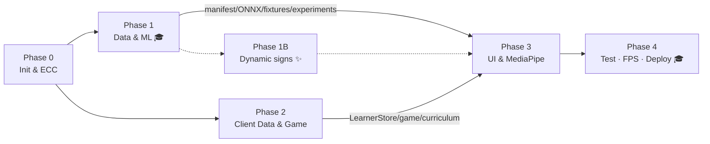

# 07 — Master Implementation Plan: SignLingo AI

> **Trạng thái:** v0.2 · **Ngày:** 2026-11-18 · **v0.2:** bỏ backend; Phase 2 đổi thành *Client Data & Game*; thêm deploy Vercel.
> Truy vết: `FT-*`, `AC-*` ([01_PRD](01_PRD.md)) · lưu trữ ([03_DATA_STORAGE](03_DATA_STORAGE.md)) · hợp đồng ([04_CONTRACTS](04_CONTRACTS.md)).
> **Quy tắc task:** mỗi task ≤ ~100 dòng code nguồn (không tính test/lock/file sinh); 1 task = 1 lượt Agent = 1 commit. Vòng: **Plan → Review Plan → Code → Test**. Task gắn **[R]** phải duyệt plan trước khi code.
> Ký hiệu: 🎓 = bắt buộc cho chấm điểm Tuần 5 · 🚀 = MVP · ✨ = mở rộng · ♻ = port từ mã Tuần 3–4 nếu có · ☑ = xong · ☐ = chưa.

---

## 0. Lộ trình tổng & cổng chất lượng



| Cổng | Điều kiện qua cổng |
|---|---|
| G0 | CI xanh trên GitHub cho `ml/`, `frontend/`, e2e smoke; bản "Hello" deploy được lên Vercel với header COOP/COEP |
| G1 | AC-ML-01..09 đạt; manifest + ONNX + fixture + experiments JSON đã publish vào `frontend/public/` |
| G2 | `src/storage`, `src/game`, `src/content` có unit test xanh; AC-GAM-01, AC-ACC-01/02 đạt ở mức unit/integration |
| G3 | Luồng học Cấp 1 chạy end-to-end với fake camera; AI Lab hiển thị số từ JSON |
| G4 | AC-PERF-01..03, AC-UI-02, AC-PRIV-01 đạt trên bản deploy Vercel; README hoàn chỉnh (AC-REPO-*) |

### Đường găng cho Tuần 5 (🎓)
P0 còn lại → **P1 (toàn bộ trừ 1B)** → P3-01, P3-07..15, P3-20..22 (Free Practice + AI Lab) → P4-01..07, P4-10..12.
Phase 2 và phần còn lại của Phase 3 (Skill Tree, Lesson Player đầy đủ, gamification) làm song song nếu đủ người, nếu không thì sau buổi chấm.

> **Phụ thuộc chưa rõ:** mã nguồn Tuần 3–4 (`src/data.py`, `src/train_baselines.py`, `src/cnn_numpy.py`, web "Tay Nói") và file `keypoint.csv` không có trong repo. Nếu được cung cấp, các task ♻ là *port + refactor + thêm test*.

---

## Phase 0 — Khởi tạo & ECC

**Context:** 02_ARCH §3, §8, §9 · 06_ECC.

| ☐/☑ | ID | Task | Files | Guide | Test |
|---|---|---|---|---|---|
| ☑ | P0-01 🎓 | Git init, `.gitignore`, `.editorconfig`, `README.md` khung | gốc | — | — |
| ☐ | P0-01b | `LICENSE` | gốc | **Chờ người dùng chọn loại giấy phép** | — |
| ☑ | P0-02 🎓 | `CLAUDE.md` gốc + `ml/`, `frontend/` + `.claude/settings.json` (permissions) | theo 06 §2 | Đã đồng bộ v0.2 | — |
| ☑ | P0-03 🎓 | Scaffold `ml/` (pyproject, ruff, pytest, `config.py` seed 42 + 24 nhãn) | `ml/` | Tạm dùng venv + pip | Unit: 3 test config ✅ |
| ~~P0-04~~ | — | ~~Scaffold backend~~ | — | **Bỏ (v0.2)**, đã xóa thư mục | — |
| ☑ | P0-05 🎓 | Scaffold `frontend/` (Vite, React 19, TS 6, Tailwind 4, Vitest, ESLint C1/C3) | `frontend/` | TS ghim 6.x | Unit: render App ✅; build ✅ |
| ~~P0-06~~ | — | ~~docker-compose Postgres~~ | — | **Bỏ (v0.2)**, đã xóa | — |
| ☑ | P0-07 🎓 | `shared/contracts/schemas/model_manifest.schema.json` | `shared/` | — | Unit (ml): 6 test schema ✅ |
| ☑ | P0-08 🎓 | CI GitHub Actions: job `ml`, `frontend` | `.github/` | Đã bỏ job backend | ☐ **Chưa chạy trên GitHub** |
| ☑ | P0-09 🎓 | `e2e/` Playwright + Chrome fake camera | `e2e/` | `PW_CHANNEL=chrome` dùng Chrome cài sẵn | E2E smoke ✅ (local) |
| ☐ | P0-10 | Cài skills theo 06 §3 + tạo `.claude/agents`, `.claude/skills` nội bộ | `.claude/` | **Chờ duyệt danh sách skill** | — |
| ☑ | P0-11 🎓 | `frontend/vercel.json` (SPA rewrite, COOP/COEP, CSP, Permissions-Policy, cache) + Vite dev/preview cùng header COOP/COEP | `frontend/` | Theo 02 §7, §9. CSP chỉ áp trên Vercel; script chống nháy theme (P3-01) phải là file ngoài hoặc thêm hash vào CSP | E2E `crossOriginIsolated` ✅ (local dev) · ☐ kiểm lại trên Preview URL |
| ☐ | P0-12 | Hooks (ruff format, prettier, chặn ghi thư mục cấm) + script CI C7 (≤ 100 dòng/task) | `.claude/`, `.github/` | 06 §4–5 | Thử sửa file → hook chạy |
| ☐ | P0-13 🎓 | Ghim runtime: `.nvmrc` (Node LTS dùng chung máy & CI), `.python-version`, `engines`; `.gitattributes` (`eol=lf`); cài **uv** + `uv.lock` (hoặc chốt pip + `requirements.lock`) | gốc, `ml/` | Đồng bộ CI | CI xanh với đúng phiên bản |
| ☐ | P0-14 🎓 | Commit baseline, push GitHub, tạo project Vercel (Root = `frontend/`), xác nhận Preview + Production | — | **Người dùng: chủ project Vercel, repo public/private** | URL production mở được, camera xin quyền được (HTTPS) |

**3 lớp kiểm thử Phase 0:** Unit = config, schema, App · Integration = `pnpm build` + `pnpm preview` có header đúng · E2E = Playwright smoke + `crossOriginIsolated` (local và trên Preview URL).

---

## Phase 1 — Data & ML Pipeline 🎓

**Mục tiêu:** tái lập Tuần 3–4 trong cấu trúc mới + PyTorch + ONNX + landmark model web + signer-holdout + publish vào `frontend/public/`. **Context:** 01_PRD §2, §5.1, §6.1 · 02_ARCH §4 · 03_DATA §4–5 · 04_CONTRACTS §2–4 · `docs/reports/*`.

### 1A. Dữ liệu ảnh (Sign Language MNIST)

| ☐ | ID | Task | Files (`ml/src/signlingo_ml/…`) | Guide | Test |
|---|---|---|---|---|---|
| ☐ | P1-01 ♻ | Load CSV + quality report (NaN, dup, label range, balance, pixel range) | `data/load.py`, `data/quality.py` | Dataclass `QualityReport`, ghi JSON | Unit: fixture có NaN/dup → đếm đúng |
| ☐ | P1-02 ♻ | Clean + transform (remap nhãn, /255, reshape) | `data/transform.py` | Hàm thuần | Unit: nhãn 10→9, 24→23; giá trị ∈ [0,1] |
| ☐ | P1-03 ♻ [R] | Group split: thumbnail 10×10 → Ward 70 cụm/lớp → 15% cụm = val; lưu `split_v1.parquet` | `data/split.py` | `n_groups=70, val_frac=0.15, seed=42` trong YAML | Unit: **0 group overlap** (AC-ML-02), val ≈ 15% ± 1%, deterministic |
| ☐ | P1-04 | Guard: `load_split(name, final=False)` raise nếu đọc `test` khi chưa `final` | `data/access.py` | Dùng ở mọi script train/tune | Unit |
| ☐ | P1-05 ♻ | Features: pixel 784, HOG 1296 | `features/pixel.py`, `features/hog.py` | scikit-image | Unit: shape |
| ☐ | P1-06 ♻ | Augment (rot ±10°, shift ±2, zoom .9–1.1, bright/contrast ±15%, **no hflip**) | `features/augment.py` | p = 0,7 | Unit: không hflip; seed tái lập |
| ☐ | P1-07 | Metrics: acc, macro-F1, per-class F1, CM row-norm, top-k confusions, latency | `evaluate/metrics.py` | Khớp sklearn | Unit |
| ☐ | P1-08 | Experiment logger theo `experiment.schema.json` (tạo schema trong task này) | `evaluate/logger.py`, `shared/contracts/schemas/experiment.schema.json` | 04 §4.2 | Unit: validate schema |
| ☐ | P1-09 ♻ | Baselines: Majority, LR, RF(200), LinearSVM, MLP 256-128 × {pixel, HOG} | `train/baselines.py`, `configs/baselines.yaml` | Scaler fit trên train (AC-ML-03) | Unit: scaler mean = mean(X_train) |
| ☐ | P1-10 | Leakage study: LR pixel, random vs group split | `train/leakage_study.py` | kind = `leakage_study` | Integration: gap random > gap group |

### 1B'. CNN PyTorch

| ☐ | ID | Task | Files | Guide | Test |
|---|---|---|---|---|---|
| ☐ | P1-11 | CNN (Conv16→Pool→Conv32→Pool→Dense128+Dropout→24) | `models/cnn.py` | 208.728 tham số như Tuần 4 | Unit: số tham số; shape |
| ☐ | P1-12 [R] | Trainer: Adam wd 1e-4, cosine LR, label smoothing .05, batch 128, early stop theo val macro-F1 (patience 3), deterministic | `train/trainer.py` | Dùng lại cho landmark MLP | Unit: 2 epoch tiny → loss giảm; cùng seed → cùng kết quả |
| ☐ | P1-13 | Sweep 4 cấu hình + tăng epoch tới 30 | `configs/cnn_*.yaml`, `train/run_cnn.py` | Chọn theo val | Integration: 1 config tiny → JSON |
| ☐ | P1-14 ♻ | So với bản NumPy Tuần 4 (nếu có trọng số) | `evaluate/compare_numpy.py` | | — |

### 1C. Landmark model (cho web)

| ☐ | ID | Task | Files | Guide | Test |
|---|---|---|---|---|---|
| ☐ | P1-15 [R] | `normalize_lm_v1` (mirror-to-right, wrist-origin, scale max xy; scale = 0 → None) | `landmarks/normalize.py` | 04 §3.3 | Unit (hypothesis): bất biến tịnh tiến & tỉ lệ |
| ☐ | P1-16 | Sinh golden fixture `landmarks_lm-v1.json` (≥ 50 mẫu, có tay trái, có ca scale = 0) | `landmarks/fixtures.py` | Ghi vào `shared/contracts/fixtures/` | Unit: round-trip |
| ☐ | P1-17 | Loader `keypoint.csv` + `ingest.py` đọc `ml/data/raw/webcam/*.json` (schema `landmark_capture`) với `session_id`, `signer_id` | `landmarks/dataset.py`, `landmarks/ingest.py`, `shared/contracts/schemas/landmark_capture.schema.json` | Kiểm giả định "20% cuối mỗi lớp = phiên sau" bằng cách xem dữ liệu, ghi lại | Unit: không trùng session giữa train/val |
| ☐ | P1-18 | Landmark augment: mirror, xoay ±15°, jitter, scale | `landmarks/augment.py` | Sau normalize | Unit |
| ☐ | P1-19 | Landmark-MLP 42→128→64→24 (PyTorch) qua `trainer.py` | `models/landmark_mlp.py`, `configs/lm_mlp.yaml` | Thử `xyz` nếu đủ dữ liệu webcam | Integration: tiny → JSON |
| ☐ | P1-20 | Class templates (15 góc khớp mean/std mỗi lớp) + `confusable` từ CM | `landmarks/templates.py` | Dùng cho FT-LRN-04 | Unit: ngón duỗi ≈ 180° |
| ☐ | P1-21 🎓 | Signer-holdout eval (**cần ≥ 3 người × 30–50 mẫu/chữ thu bằng `/collect` hoặc script tạm**) | `evaluate/signer_holdout.py` | Leave-one-signer-out | Integration: fixture 2 signer giả lập |

> Nếu trang `/collect` (P3-24) chưa xong khi cần thu dữ liệu, dùng script Python tạm `ml/tools/capture.py` (OpenCV + MediaPipe Python) xuất **cùng schema** `landmark_capture`.

### 1D. Export, Publish & Báo cáo

| ☐ | ID | Task | Files | Guide | Test |
|---|---|---|---|---|---|
| ☐ | P1-22 | Export ONNX (opset 17) CNN + Landmark-MLP; softmax ngoài graph | `export/onnx_export.py` | Dynamic batch | Integration: **parity ≤ 1e-4** (AC-ML-08) |
| ☐ | P1-23 | Manifest builder (sha256, labels, preprocess_version, recommended, templates, confusable, metrics) | `export/manifest.py` | Schema P0-07 | Unit |
| ☐ | P1-24 | Publish: copy vào `frontend/public/models/` + `index.json`; experiments → `frontend/public/data/experiments/` + `index.json` (tạo `model_index`, `experiment_index` schema) | `export/publish.py` | Không ghi đè version cũ; bỏ trường nặng | Integration: đủ file, đúng schema |
| ☐ | P1-25 | Figures: CM, per-class F1, bar so sánh, leakage, curves | `evaluate/figures.py` | `reports/figures/` | Integration: PNG tồn tại |
| ☐ | P1-26 🎓 | Entrypoint `python -m signlingo_ml.pipeline all\|data\|baselines\|cnn\|landmarks\|export\|publish` | `pipeline.py` | Idempotent, cache | **E2E ML:** `all` trên tiny trong CI (< 5 phút); đầy đủ trên máy nhóm → AC-ML-01, 05, 06 |
| ☐ | P1-27 🎓 | `ml/README.md` + `reports/RESULTS.md` (RQ1–RQ3, số lấy từ JSON) | docs | Bám rubric | Review thủ công |

**3 lớp kiểm thử Phase 1:** Unit = transform, split, guard, features, augment, metrics, normalize, templates, manifest · Integration = pipeline con trên `tiny_mnist.csv`, `tiny_keypoint.csv`; ONNX parity; publish đúng schema · E2E = `pipeline all` từ repo sạch, chạy 2 lần lệch Macro-F1 ≤ 0,005.

---

## Phase 1B — Dynamic signs (J, Z, từ vựng Cấp 3) ✨

> **Gated:** cần người dùng chọn nguồn dữ liệu chuỗi landmark (kiểm giấy phép) hoặc tự thu.

| ☐ | ID | Task | Guide | Test |
|---|---|---|---|---|
| ☐ | P1B-01 [R] | Chọn dataset + danh sách từ (người dùng duyệt) | ADR | — |
| ☐ | P1B-02 | Loader chuỗi, resample T = 32, normalize lm-v1 từng khung | `landmarks/sequence.py` | Unit: shape (T, 42) |
| ☐ | P1B-03 | GRU 2 lớp / 1D-CNN temporal | `models/seq_model.py` | Unit |
| ☐ | P1B-04 | Train + eval (signer split) + export ONNX + manifest task `dynamic_words` | | Integration: parity |

---

## Phase 2 — Client Data & Game 🚀 (thay cho Backend)

**Mục tiêu:** lớp dữ liệu và luật chơi chạy hoàn toàn trong trình duyệt. **Context:** 01_PRD §5.2–5.4, §6.3 · 02_ARCH §6 · 03_DATA · 04_CONTRACTS §6–7.

| ☐ | ID | Task | Files (`frontend/src/…`) | Guide | Test |
|---|---|---|---|---|---|
| ☐ | P2-01 | Types dùng chung (`Settings`, `Stats`, `SessionRecord`, `PerfRecord`, `Curriculum`…) | `storage/types.ts`, `content/types.ts` | Theo 03 §3 | Typecheck |
| ☐ | P2-02 [R] | Storage adapter: get/set JSON có try/catch, fallback bộ nhớ, `available`, prefix `signlingo:v1:` | `storage/kv.ts` | Ném lỗi không ra ngoài | Unit: localStorage throw → fallback, `available=false` (AC-ACC-02) |
| ☐ | P2-03 | Migration framework (`schema_version`, `migrate(v→v+1)`) | `storage/migrate.ts` | v1 là bản đầu | Unit: dữ liệu thiếu version → v1 |
| ☐ | P2-04 | ESLint C3 (`game/**` không React) + C4 (`no-restricted-globals localStorage` ngoài `storage/**`) | `eslint.config.js` | | Lint bắt vi phạm mẫu |
| ☐ | P2-05 [R] | `game/hearts.ts`: `applyHeartRegen`, `loseHeart` (chỉ khi confidence ≥ ngưỡng) | `game/hearts.ts` | Tiêm `now` | Unit: 5 → mất 2 → +65 phút → 5 (cap) |
| ☐ | P2-06 [R] | `game/streak.ts`: `applyDailyXp` theo múi giờ | `game/streak.ts` | `Intl.DateTimeFormat` lấy ngày theo TZ | Unit: qua nửa đêm, bỏ 1 ngày → 0 (AC-GAM-02) |
| ☐ | P2-07 | `game/xp.ts`: `computeXp` | `game/xp.ts` | Quy tắc 03 §3.5 | Unit: breakdown |
| ☐ | P2-08 | `game/unlock.ts`: `lessonStatus` theo `requires` | `game/unlock.ts` | | Unit |
| ☐ | P2-09 | `LearnerStore`: settings, stats, progress, daily, sign_stats | `storage/learnerStore.ts` | Dùng P2-02..08 | Unit |
| ☐ | P2-10 | `LearnerStore` sessions: `startSession`, `recordAttempt`, `completeSession` (idempotent), `abandonSession`; giới hạn 200 bản ghi | `storage/sessions.ts` | | Unit: complete 2 lần → XP 1 lần (AC-GAM-01) |
| ☐ | P2-11 | Benchmarks: `saveBenchmark`, `listBenchmarks` (≤ 20) | `storage/benchmarks.ts` | | Unit |
| ☐ | P2-12 | Schemas `backup`, `curriculum` + validator `ajv` | `shared/contracts/schemas/*.json`, `storage/validate.ts` | | Unit |
| ☐ | P2-13 | Export/Import/Clear backup | `storage/backup.ts` | Hỏi xác nhận ở UI, không ở đây | Integration: export → clear → import ra cùng state (AC-ACC-01); file sai → `BACKUP_INVALID` |
| ☐ | P2-14 [R] | Curriculum loader + validate + suy `signs` 24 chữ từ `manifest.labels`; **file `curriculum.json` với nội dung do người dùng cung cấp** | `content/loader.ts`, `content/curriculum.json` | Không tự bịa bài/từ/hint | Integration: `model_class_index` khớp `manifest.labels` |
| ☐ | P2-15 | Zustand store kết nối `LearnerStore` (hook `useLearner`) | `storage/useLearner.ts` | Chỉ hook này chạm store | Unit |

**3 lớp kiểm thử Phase 2:** Unit = hearts, streak, xp, unlock, kv fallback, migrate · Integration = `LearnerStore` trên jsdom localStorage thật: luồng start → attempts → complete → reload → đọc lại; export/import round-trip; curriculum ↔ manifest · E2E = (ở Phase 3/4) reload trình duyệt vẫn giữ XP/streak; chế độ storage bị chặn hiện banner.

---

## Phase 3 — Frontend UI & MediaPipe

**Mục tiêu:** UI theo docs/05 + engine K3. **Context:** Prototype V0 + 05_UI + 01_PRD + 02_ARCH §5 + 03_DATA §3 + 04_CONTRACTS §3, §5–6.

### 3A. Nền tảng UI

| ☐ | ID | Task | Files (`frontend/src/…`) | Guide | Test |
|---|---|---|---|---|---|
| ☐ | P3-01 🎓 | `tokens.css` (light/dark) + Tailwind map + script chống nháy + `ThemeToggle` | `styles/`, `components/ui/ThemeToggle.tsx` | Hex đúng 05 §2 | Unit: đổi `data-theme`, nhớ lựa chọn (AC-UI-01) |
| ☐ | P3-02 | `Button` 3D, `Card`, `ProgressBar`, `StatChip` | `components/ui/` | Radix Slot | Unit: variants, a11y |
| ☐ | P3-03 | AppShell: Sidebar/BottomNav/TopBar + React Router + ESLint C5 (cấm hex) | `app/`, `components/layout/` | | Unit: nav active |
| ☐ | P3-04 🚀 | Landing lần đầu + banner nhắc sao lưu + banner storage bị chặn | `features/onboarding/` | 05 §4, §5.1 | Unit |
| ☐ | P3-05 | Static data loader: fetch `/models/index.json`, `/data/experiments/index.json` có kiểm schema, lỗi rõ ràng | `app/staticData.ts` | Không fetch ngoài origin | Unit (mock fetch) |
| ☐ | P3-06 🚀 | Dashboard Skill Tree (`SkillNode`, unit banner, popover) | `features/skill-tree/` | Zig-zag | Unit: trạng thái node từ `lessonStatus` |

### 3B. Vision engine (TS thuần — `src/vision/`)

| ☐ | ID | Task | Files | Guide | Test |
|---|---|---|---|---|---|
| ☐ | P3-07 🎓 | `camera.ts` + `useCamera` (640×480, chọn thiết bị, lỗi DENIED/NOT_FOUND/INSECURE_CONTEXT) | `vision/camera.ts`, `hooks/useCamera.ts` | Dừng track khi unmount | Unit: mock mediaDevices |
| ☐ | P3-08 🎓 | `HandTracker` tasks-vision (GPU→CPU), script `fetch-mediapipe` tự host wasm + `.task` (ghim version) | `vision/landmarker.ts`, `scripts/fetch-mediapipe.mjs` | `VIDEO`, `numHands: 1` | Integration (Playwright): init trong Chrome |
| ☐ | P3-09 🎓 | `normalizeLandmarks` lm-v1 | `vision/normalizer.ts` | | **Integration: khớp fixture Python ≤ 1e-6 (AC-ML-09)** |
| ☐ | P3-10 🎓 | `Classifier` ORT-web (webgpu→wasm), kiểm sha256, tái dùng tensor | `vision/classifier.ts` | Load theo manifest | Integration: output = Python cho 10 mẫu fixture |
| ☐ | P3-11 🎓 | `Smoother` (cửa sổ 5 / EMA) + top-K | `vision/smoother.ts` | | Unit |
| ☐ | P3-12 🎓 | `HoldVerifier` FSM (grace 150 ms, timeLimit) | `vision/holdFsm.ts` | 02 §5.2 | Unit: verified đúng mốc 1000 ms (AC-LRN-01) |
| ☐ | P3-13 🎓 | `RecognitionEngine` + `PerfMonitor` (p50/p95, processing FPS) + throttle 30 Hz + `recordBenchmark` | `vision/engine.ts`, `vision/perf.ts` | rVFC loop | Unit: p95 đúng |
| ☐ | P3-14 🚀 | `fingerFeedback` (15 góc, so template, `confusable`) | `vision/fingerFeedback.ts` | k = 2σ, min 20° | Unit |
| ☐ | P3-15 🎓 | `CameraFrame` + overlay canvas (skeleton, ngón đỏ, các state) | `components/vision/` | Mirror CSS | Unit: render các state |

### 3C. Màn hình

| ☐ | ID | Task | Files | Guide | Test |
|---|---|---|---|---|---|
| ☐ | P3-16 🚀 | Lesson Player khung (progress, hearts, item router) dùng `useLearner` | `features/lesson/` | | Unit |
| ☐ | P3-17 🚀 | Item `learn_card`, `perform_sign` (HoldRing, gợi ý, near-miss), `choose_sign` | `features/lesson/items/` | | Unit |
| ☐ | P3-18 🚀 | Item `spell_word` (chữ lặp cần nhả tay) | như trên | AC-LRN-05 | Unit: "LL" |
| ☐ | P3-19 🚀 | Màn kết quả (`CompleteResult`) + âm thanh (tắt được) + confetti (reduced-motion) | `features/lesson/` | | Unit |
| ☐ | P3-20 🎓 | Free Practice (`/practice`) | `features/practice/` | Không trừ tim | Unit |
| ☐ | P3-21 🎓 | AI Lab Benchmark + Leakage (Recharts) từ `/data/experiments` | `features/lab/` | Không hardcode số | Unit: render từ JSON test |
| ☐ | P3-22 🎓 | AI Lab ConfusionMatrix SVG + per-class F1 + Live Monitor (24 bars, FpsMeter, ghi & tải benchmark) | `features/lab/` | | Unit |
| ☐ | P3-23 🚀 | Profile + Settings (theme, tay thuận, camera, âm, mục tiêu, tên; Xuất/Nhập/Xóa có xác nhận) | `features/profile/`, `features/settings/` | | Unit |
| ☐ | P3-24 🎓 | Collect page: mã người ra dấu, đếm ngược, ghi landmark, xem lại, **tải file JSON** theo `landmark_capture` | `features/collect/` | Không lưu ảnh | Unit: file đúng schema |
| ☐ | P3-25 ✨ | Item `perform_dynamic` (buffer 32 khung) — sau P1B | | | Unit |

**3 lớp kiểm thử Phase 3:** Unit = mọi module `vision/*`, component states, stores · Integration = normalizer ↔ fixture Python; classifier ↔ ONNX Python; UI + `LearnerStore` thật (jsdom) · E2E (Playwright, Chrome fake camera với video `.y4m` nhóm quay): (1) mở app lần đầu → bài 1 → verify chữ A → màn kết quả → reload vẫn còn XP; (2) từ chối camera (AC-LRN-03); (3) không có tay > 2 s (AC-LRN-02); (4) toggle dark mode; (5) AI Lab hiển thị bảng từ JSON; (6) Collect tải được file đúng schema.

---

## Phase 4 — Kiểm thử tổng thể, Tối ưu FPS & Deploy 🎓

**Context:** 01_PRD §6 · 02_ARCH §5.4, §7, §9.

| ☐ | ID | Task | Guide | Test / Bằng chứng |
|---|---|---|---|---|
| ☐ | P4-01 🎓 | Đo baseline thời gian xử lý (60 s) trên laptop tham chiếu, lưu `ml/reports/perf/baseline.json` | Nút "Ghi 60 s" | Số trước tối ưu |
| ☐ | P4-02 🎓 | Tối ưu main-thread: rVFC, canvas trực tiếp, throttle, thử 640×480 / 480×360 | Đo từng thay đổi | Bảng ablation |
| ☐ | P4-03 🎓 | Kiểm COOP/COEP trên Vercel Preview → WASM threads; thử WebGPU EP | | cls_ms theo backend |
| ☐ | P4-04 🎓 [R] | Web Worker: HandLandmarker + ORT trong worker (ImageBitmap) | Interface K3 giữ nguyên | E2E vẫn xanh; số so sánh |
| ☐ | P4-05 | Quantize int8; Macro-F1 giảm ≤ 0,005 | ml export | ML integration |
| ☐ | P4-06 🎓 | **Perf E2E**: 60 s fake camera, đọc `getPerf()`, assert frame p50 ≤ 33 ms & p95 ≤ 40 ms (trên máy tham chiếu; CI chỉ cảnh báo) | | AC-PERF-01..03 |
| ☐ | P4-07 🎓 | Privacy E2E: mọi request cùng origin; không payload ảnh/video/landmark | | AC-PRIV-01, C2, C6 |
| ☐ | P4-08 | A11y: axe-core 6 màn × 2 theme; bàn phím luồng học | | AC-UI-02 |
| ☐ | P4-09 | E2E dữ liệu: học 1 bài → reload → XP/streak còn; export → xóa → import; storage bị chặn → banner | | AC-GAM-01, AC-ACC-01/02 |
| ☐ | P4-10 🎓 | README gốc + `reports/RESULTS.md` (RQ1–3, bảng, hình, link Vercel, giới hạn, hướng phát triển) | Bám Week 5 | AC-REPO-01..03 |
| ☐ | P4-11 🎓 | Deploy Production Vercel; chạy lại E2E smoke + perf trên URL production | | URL hoạt động, header đúng |
| ☐ | P4-12 🎓 | Kịch bản demo + dự phòng (mạng yếu → `pnpm preview` localhost; camera lỗi → video fake) | | Diễn tập |

**3 lớp kiểm thử Phase 4:** Unit = micro-benchmark normalizer/classifier (< 2 ms) · Integration = worker ↔ engine protocol; ONNX quantized parity · E2E = perf 60 s, privacy, a11y, dữ liệu cục bộ, smoke trên production.

---

## 5. Ma trận AC → Task

| AC | Task |
|---|---|
| AC-ML-01 | P1-26 |
| AC-ML-02/03 | P1-03, P1-04, P1-09 |
| AC-ML-04/05 | P1-09, P1-13 |
| AC-ML-06 | P1-19, P1-21 |
| AC-ML-07 | P1-07, P1-25, P1-27 |
| AC-ML-08 | P1-22 |
| AC-ML-09 | P1-16, P3-09 |
| AC-PERF-01..03 | P4-01..06, P4-11 |
| AC-LRN-01..05 | P3-12, P3-15, P3-17, P3-18, E2E Phase 3 |
| AC-GAM-01..03 | P2-05..10, P4-09 |
| AC-ACC-01/02 | P2-02, P2-13, P3-04, P4-09 |
| AC-UI-01/02 | P3-01, P4-08 |
| AC-PRIV-01 | P0-11 (CSP), P4-07 |
| AC-REPO-01..03 | P0-08, P0-14, P4-10 |

## 6. Mẫu output Agent cho mỗi task (task-protocol)

```
### P1-03 Group split
Plan: …(file, hàm, test)…            ← chờ duyệt nếu [R]
Diff: data/split.py (+78), tests/unit/test_split.py (+60)
Tests: python -m pytest tests/unit/test_split.py -q → 6 passed
AC: AC-ML-02 ✅
Notes/Risks: …
Next: P1-04
```

## 7. Ánh xạ sang báo cáo Tuần 5 (môn học)

| Yêu cầu Week 5 | Nguồn |
|---|---|
| Full DL pipeline demo Data → Model → Output | P1-26 + Free Practice/AI Lab trên URL Vercel + P4-12 |
| Final model performance summary | AI Lab + `reports/RESULTS.md` |
| Limitations & risks | PRD §8 + RESULTS.md (domain gap, signer ít, XP cục bộ sửa được) |
| Future improvements | Phase 1B, P4-05, thu dữ liệu đa người, đồng bộ tài khoản nếu có backend sau này |
| Final GitHub review | AC-REPO-*, P1-26 |
| 8 mục weekly (What/When/Why/Who/How much/risks/changes/issues) | Nhóm tự điền; "Major changes": bỏ backend, deploy Vercel (2026-11-18) |

## 8. Việc người dùng cần làm / quyết định

| # | Việc | Chặn task |
|---|---|---|
| U1 | Gửi mã nguồn Tuần 3–4 + `keypoint.csv` | Các task ♻, P1-17 |
| U2 | Câu chữ chính thức RQ1–RQ3 | P1-27 |
| U3 | Ngôn ngữ UI (VI/EN/song ngữ) | P3-01..03 (i18n) |
| U4 | Nội dung `curriculum.json`: danh sách bài, từ Cấp 2, hint; ảnh/âm thanh có giấy phép | P2-14, P3-17 |
| U5 | Chủ project Vercel; repo public/private; `LICENSE` | P0-01b, P0-14 |
| U6 | Cài uv (hoặc chốt pip) | P0-13 |
| U7 | Thu dữ liệu ≥ 3 người; quay video fake-camera | P1-21, E2E Phase 3 |
| U8 | Duyệt danh sách skill | P0-10 |
| U9 | Cấu hình laptop tham chiếu | AC-PERF-01 |
